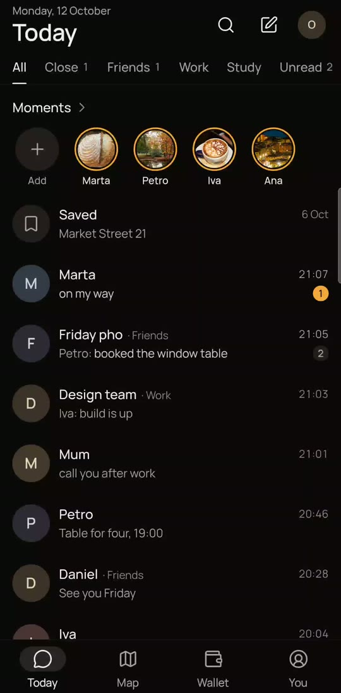
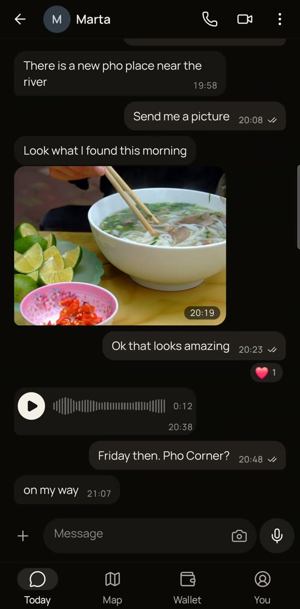
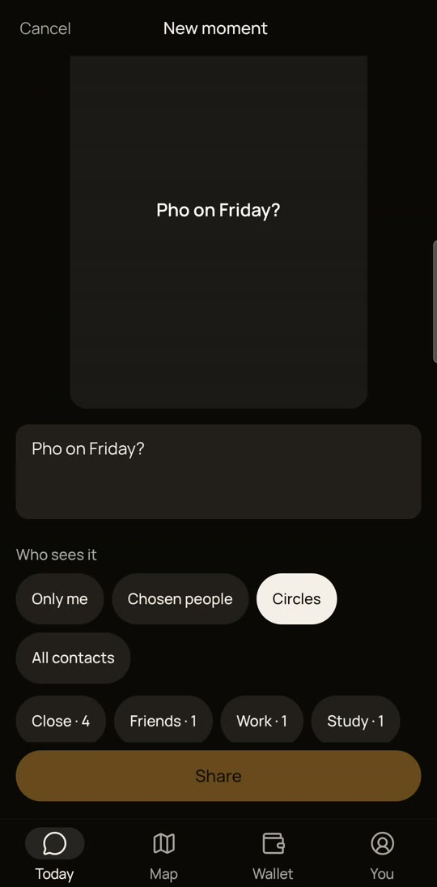
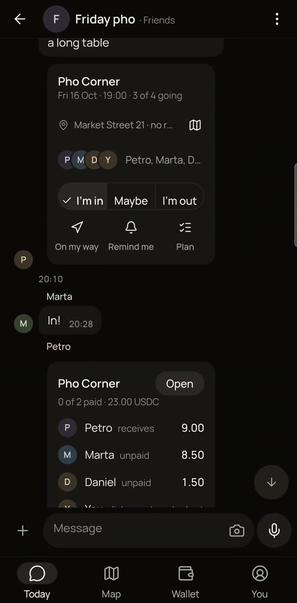
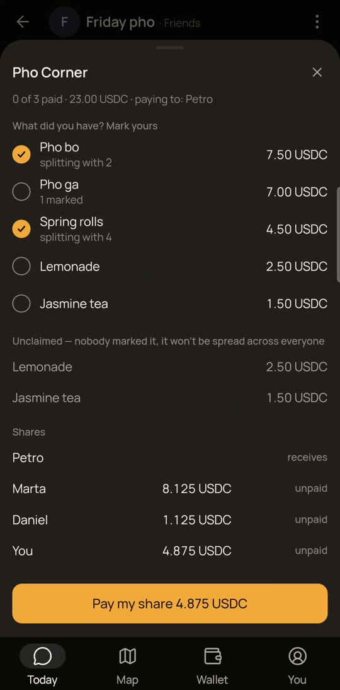
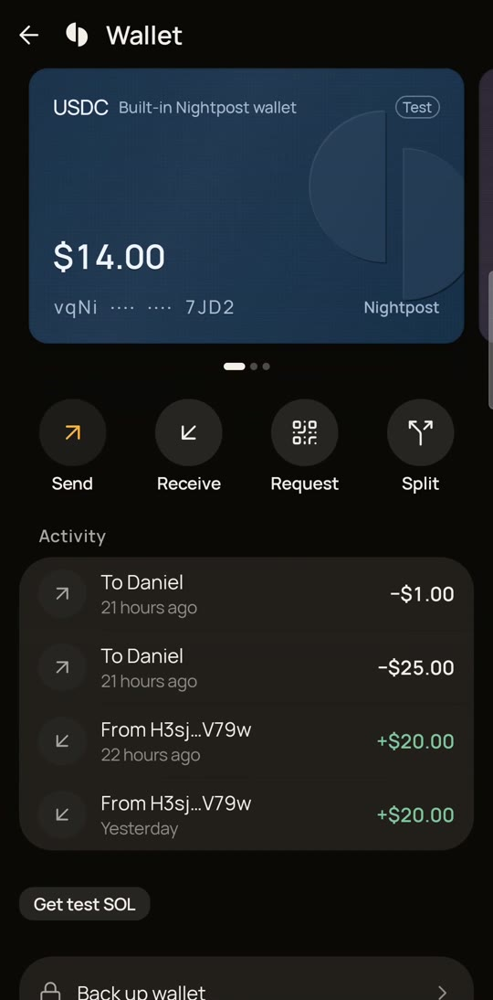
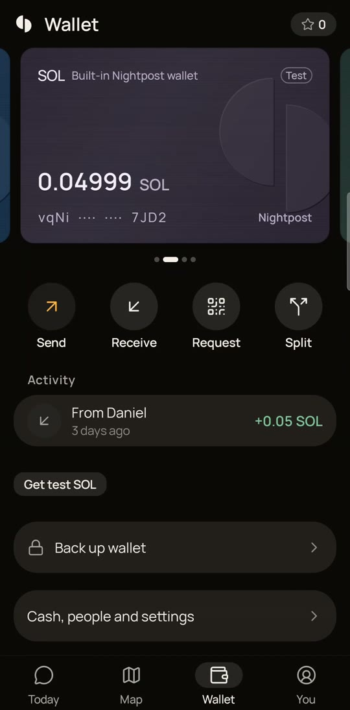
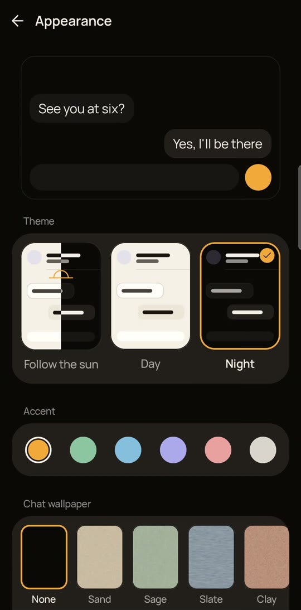
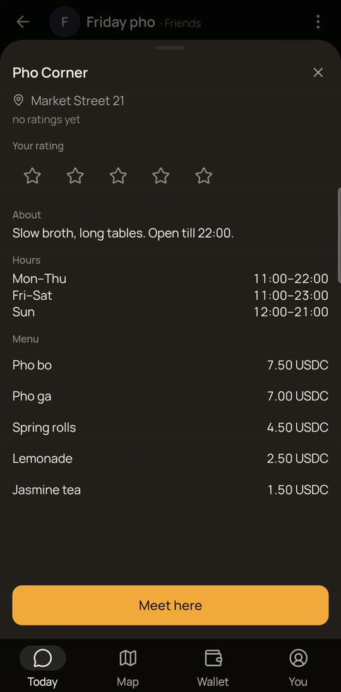
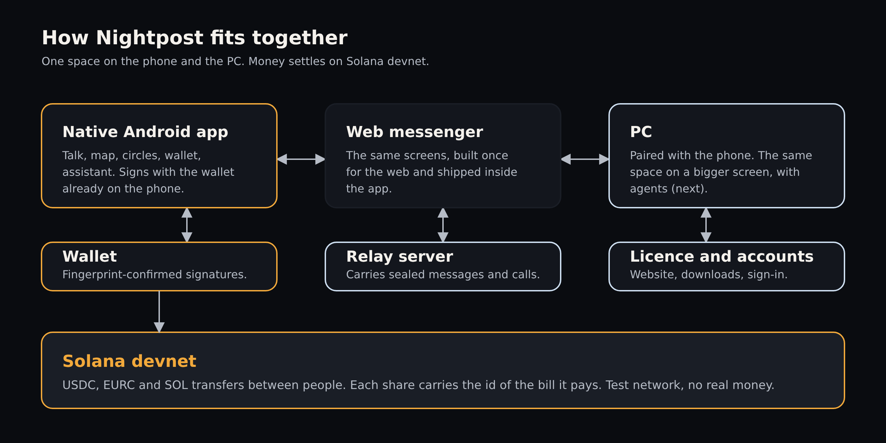

  <picture>
    <source media="(prefers-color-scheme: dark)" srcset="docs/img/mark-dark.svg">
    
  </picture>
   <b>Nightpost</b>

  

  <a href="https://youtu.be/HMCDmwgEBbk"><b>Demo (2:19)</b></a> ·
  <a href="https://youtu.be/adhv_zvUgwE"><b>Pitch (1:54)</b></a> ·
  <a href="docs/nightpost-deck.pdf"><b>Deck (PDF)</b></a> ·
  <a href="https://github.com/Kiril003/phantom-solana/raw/main/nightpost.apk"><b>Android APK</b></a> ·
  <a href="https://phantom-os.dev"><b>Website</b></a>

  
  
  
  

---

## Everything your phone is for, joined

You talk, share, sort people into circles, find places, plan the evening and pay. Today each of those jobs lives in a different app, and you carry the context between them by hand.

**Nightpost keeps them in one space**, with an assistant across it. A plan with friends goes from "let's meet" to a settled bill in one chat: the place, who's in, the split by dish and each person's payment on Solana.

## On the phone, build 17

<table>
  <tr>
    <td align="center" valign="top" width="33%"> <b>Today</b> Moments, circles, conversations</td>
    <td align="center" valign="top" width="33%"> <b>Talk and share</b> Photos, voice notes, calls</td>
    <td align="center" valign="top" width="33%"> <b>Moments</b> You choose who sees each one</td>
  </tr>
  <tr>
    <td align="center" valign="top" width="33%"> <b>Plan it in the chat</b> Place, time, who's in</td>
    <td align="center" valign="top" width="33%"> <b>Split by what you had</b> Pay your share in USDC</td>
    <td align="center" valign="top" width="33%"> <b>Ask once, you confirm</b> The assistant drafts, your fingerprint sends</td>
  </tr>
  <tr>
    <td align="center" valign="top" width="33%"> <b>Wallet</b> USDC, EURC and SOL, test funds</td>
    <td align="center" valign="top" width="33%"> <b>Make it yours</b> Theme, accent, wallpaper per chat</td>
    <td align="center" valign="top" width="33%"> <b>Places</b> Pages run by their owners</td>
  </tr>
</table>

Frames from the demo, recorded on a test phone running build 17. Test contacts and an invented place; money is Solana devnet test funds.

## What is built, and what is next

| | Build 17, on the phone today | Next |
|---|---|---|
| **Talk** | Chats without a phone number, groups up to 32, photos, voice notes, calls | Group calls from the group header |
| **People** | Circles: close, friends, work, study, in your own order | |
| **Moments** | Share with one circle, chosen people or everyone | |
| **Map** | Friends who chose to share, on-device routes | Places in every city |
| **Plans** | Meetup card in the group: place, time, I'm in, on my way | |
| **Money** | Pay a person in the chat, split a bill by dish; USDC, EURC and SOL; your fingerprint sends | Mainnet after an independent audit |
| **Assistant** | Drafts a payment from one sentence; only your fingerprint sends it | |
| **Places** | Pages run by their owners, with hours and menu | |
| **Your look** | Theme, accent and a wallpaper for each chat | |

## Why Solana

Money between people is small, frequent and social. It needs a transfer that settles in seconds, costs a fraction of a cent and is signed on the phone.

| | How Nightpost uses it | Status |
|---|---|---|
| **USDC and EURC** | People pay in dollars or euros, not a coin whose price moves while they pay. | Built, devnet |
| **TransferChecked + Memo** | Each share of a bill is its own transfer, and the bill id travels in an SPL Memo (`nightpost-bill:v1:<id>`), so the chain shows who paid their part. | Built, devnet |
| **Keys on the phone** | Built-in wallet with keys in the Android Keystore. On Seeker: Mobile Wallet Adapter and Seed Vault. | Built |
| **Seeker Genesis Token and SKR** | Read-only: a Seeker badge and the SKR stake tier on the profile. SKR exists only on mainnet. | Built, read-only |
| **Fee payer** | The server pays the network fee, so friends never need SOL. | Built and tested, not switched on yet |
| **Solana dApp Store** | Publisher KYC is done; the listing is next. | Next |

## How to verify

- **Install it.** [nightpost.apk](https://github.com/Kiril003/phantom-solana/raw/main/nightpost.apk), build 17, Android 10+, Solana devnet. Checksums in [docs/RELEASES.md](docs/RELEASES.md).
- **Check the chain.** [A 25 USDC bill share sent from the chat](https://explorer.solana.com/tx/RkJ9GoQ5jSyvF86BjHWmaVZ38NRkk6Tb9brBHsgP72F69YaG6crDJR27VEKL7Xe3s5zZ257VQbWY2mfsfQQP8wC?cluster=devnet): create the token account, `transferChecked`, and the Memo with the bill id. [A 0.05 SOL transfer](https://explorer.solana.com/tx/43L7ov5KPG4MNcsduLKyo9fU41wCjAU76pLMHEoXr5j5kJvhc8BZ2KsgMV5uGSjkL5hg7dDkijoPiXSK7vy8fayN?cluster=devnet).
- **Read the code.** The source is in a private repository shared with the hackathon judges.

## Architecture

  
   Messages go phone to phone, end to end; the relay passes only sealed envelopes it can't read.

**Stack:** Kotlin and Jetpack Compose; a React and TypeScript messenger inside the app; WebRTC for calls; MapLibre and OpenStreetMap; Python FastAPI on Fly.io; Solana SPL Token, Memo, Mobile Wallet Adapter, Seed Vault.

## Licence

© 2026 Kyrylo Myloserdov. **All rights reserved.** This repository holds words, pictures, the pitch deck and the Android build for evaluation. No licence is granted to use them ([LICENSE](LICENSE)). The code is private.
