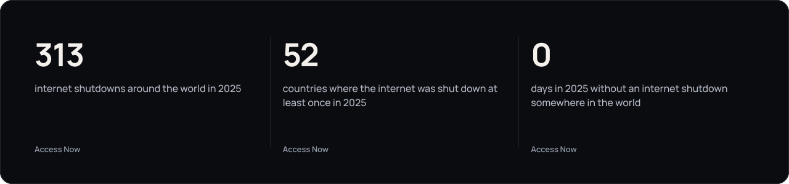
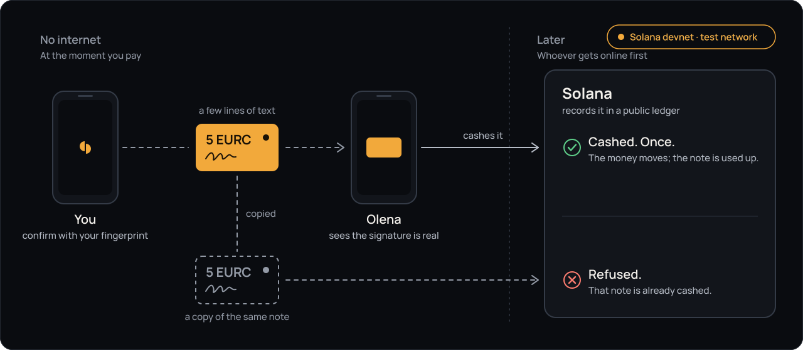
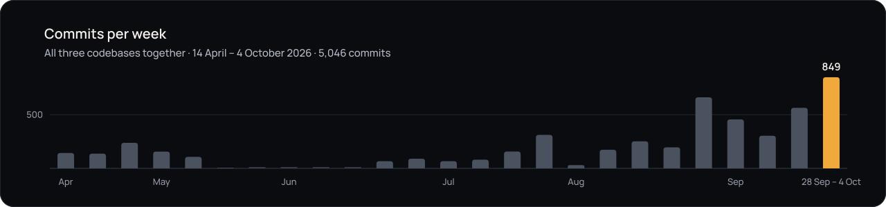

<picture>
  <source media="(prefers-color-scheme: dark)" srcset="docs/img/hero-dark.svg">
  <source media="(prefers-color-scheme: light)" srcset="docs/img/hero-light.svg">
  
</picture>

<h3 align="center">Messages, an offline map and money that keep working when the power and the internet are gone.</h3>

Світло не гасне. Месенджер і мапа, які працюють, коли мережа ні.

  <a href="https://phantom-os.dev"><b>Website</b></a>
  &nbsp;·&nbsp;
  <!-- SLOT:film-link  When the film is public, put this line back (with its link) in place of this comment:
  <a href="FILM_URL"><b>Watch the film</b></a>&nbsp;·&nbsp;
  -->
  <!-- SLOT:deck-link  When the pitch deck is public, put this line back (with its link) in place of this comment:
  <a href="DECK_URL"><b>Pitch deck</b></a>&nbsp;·&nbsp;
  -->
  <a href="https://phantom-os.dev/download"><b>Download for Android</b></a>

Early version for Android · free · no phone number needed · money only on Solana’s test network

 

**When the network goes, the phone goes dark.** Messages stop, maps go blank, card payments fail. It happened in [Spain and Portugal on 28 April 2025](https://en.wikipedia.org/wiki/2025_Iberian_Peninsula_blackout), in [Central Europe during the floods of September 2024](https://en.wikipedia.org/wiki/2024_Central_European_floods), and since 2022 it has been [part of daily life in Ukraine](https://en.wikipedia.org/wiki/Russian_strikes_against_Ukrainian_infrastructure_(2022%E2%80%93present)). Nightpost is one Android app made for those hours.

<picture>
  <source media="(prefers-color-scheme: dark)" srcset="docs/img/why-dark.svg">
  <source media="(prefers-color-scheme: light)" srcset="docs/img/why-light.svg">
  
</picture>

Sources: Banco de España, <a href="https://www.bde.es/f/webbe/GAP/Secciones/Publicaciones/InformesBoletinesRevistas/RevistaEstabilidadFinanciera/25/3_REF49_Apagon.pdf">Revista de Estabilidad Financiera 49</a> (card payments −55%; under 4% of cash machines with their own power) · ESB Networks, <a href="https://esb.ie/news---insights/press-releases/article/2025/01/26/esb-networks-restores-power-to-490-000-customers-impacted-by-storm-%C3%A9owyn-following-unprecedented-damage-as-estimated-restoration-times-now-available-on-www.powercheck.ie">press release, 26 January 2025</a> · European Commission, <a href="https://ec.europa.eu/commission/presscorner/api/files/document/print/en/ip_25_856/IP_25_856_EN.pdf">IP/25/856, March 2025</a>.

<table>
<tr>
<td width="33%" valign="top">
<b>Messages</b> 
Phones on the same Wi-Fi talk directly, even when the internet is down. When someone is far away, the message waits on our server for up to 7 days. Only the two of you can read it. No phone number needed.
</td>
<td width="33%" valign="top">
<b>An offline map</b> 
The nearest shelter in Ukraine, even with no internet. The way there is worked out on the phone itself, inside an area you saved beforehand.
</td>
<td width="33%" valign="top">
<b>Money without a network</b> 
Pay the way you would with a signed cheque: the note moves to the other phone with no internet and is cashed later, once. On Solana’s test network today.
</td>
</tr>
</table>

  <a href="#money-without-a-network">Money without a network</a> ·
  <a href="#proof-not-promises">Proof</a> ·
  <a href="#what-works-today">What works today</a> ·
  <a href="#why-solana">Why Solana</a> ·
  <a href="#built-by">Built by</a> ·
  <a href="#roadmap">Roadmap</a>

<!-- SLOT:see-it  Put this section back when docs/img/demo.gif and docs/img/screen-01.png … screen-06.png
     (real device captures, night theme, demo contacts only; each file under 1.5 MB) are committed.
     The captions are suggestions: match each one to its real screenshot before publishing.

## See it

  

<table>
<tr>
<td align="center" width="33%"> <b>Chats.</b> Messages that wait for the network.</td>
<td align="center" width="33%"> <b>A conversation.</b> Only the two of you can read it.</td>
<td align="center" width="33%"> <b>Map.</b> The nearest shelter, even with no internet.</td>
</tr>
<tr>
<td align="center" width="33%"> <b>The way there.</b> Worked out on the phone, inside a saved area.</td>
<td align="center" width="33%"> <b>Wallet, test network.</b> Keys stay on your phone.</td>
<td align="center" width="33%"> <b>Cash note, test network.</b> Handed over with no internet.</td>
</tr>
</table>

Real screenshots from the Android build. Demo contacts only.

SLOT:see-it -->

## Money without a network

No power, cards don’t work, the cash machine is dark. And you owe your neighbour 5 € for water. With Nightpost you pay as you would with a signed cheque: **the network isn’t needed at the moment you pay, only later, to credit the money**, just like a cheque written in the evening and taken to the bank in the morning.

<picture>
  <source media="(prefers-color-scheme: dark)" srcset="docs/img/cash-note-dark.svg">
  <source media="(prefers-color-scheme: light)" srcset="docs/img/cash-note-light.svg">
  
</picture>

1. **Beforehand.** While there is internet, you set a little money aside in your phone, like taking cash out of a machine.
2. **No internet.** You say who and how much, and confirm with your fingerprint. The phone writes a note and signs it with your key.
3. **Hand-over.** The note is just a few lines of text. It goes to your neighbour’s phone like an ordinary message, and her phone sees at once that the signature is real.
4. **Cashing.** As soon as either of you gets online, the note is cashed and the money moves. Once.
5. **A copy.** Every note has its own number, and the network accepts it only once. A copy of the same note is refused.

For the technically curious: each note is an ordinary Solana transfer bound to a <i>durable nonce</i> instead of a recent blockhash, so it does not expire while it waits offline. Cashing moves the nonce on, which voids every copy.

> **Test network only.** Today the money moves on Solana’s test network (devnet): it is play money, not real. Real money comes only after an independent security audit.
>
> **Until a note is cashed, it is a promise**, like a cheque. If someone gives the same note to two people, the money goes to whoever gets online first, and the other one is refused. What is at stake is only the small amount set aside beforehand.
>
> **The whole path was proven with the app’s own code, on a computer.** Between two real phones it is being tested now.

## Proof, not promises

Solana is a public ledger: every transfer is recorded for good, and anyone can open it. We ran the whole path on the test network, and each link below opens the record on Solana Explorer.

**2 October 2026 · SOL**

| What happened | What it shows | Record |
|---|---|---|
| Money set aside | 0.12 SOL moved into a separate pocket and three blank notes opened, in one transaction | [`61o2yaDD…EATbb5gj`](https://explorer.solana.com/tx/61o2yaDDMT4BND36vDhz8bgntRTcx5ioyxv6kHGk5WUhLaubitv4ozH8AaQZ9h38jaCruHfYbyBchuvrEATbb5gj?cluster=devnet) |
| A note cashed to Bob | 0.03 SOL. Signed with no network and held for 100 seconds, longer than an ordinary Solana transaction stays valid | [`2vUdu6sZ…godAuXMQ`](https://explorer.solana.com/tx/2vUdu6sZNutDRzKv6mcBMVhoiub4jWAVMeUfoypSxjYu8wHQedxvHM8vRJYbAH8J2jskvS8SU68bCqQ2godAuXMQ?cluster=devnet) |
| A second note cashed to Bob | 0.05 SOL, in the same block | [`4HWCT4pe…DQ9hni9e`](https://explorer.solana.com/tx/4HWCT4pev231pFcDwhEGhqrMxLQ9fe6pNfiRDuP1hrMNxEkfhHNwL6NbAmuHZ1JqyShgB7JcdGNDfgpYDQ9hni9e?cluster=devnet) |
| A copy of that note, to Carol | **Refused** by the network: the note was already used. There is no record, and that is the proof | [`v4SvR4KH…QrPJBQRv`](https://explorer.solana.com/tx/v4SvR4KHgWG5xJv9T1WDvhEkjysf5bnZPfQsodBvhF1vEcU4RLqE8cCcZ2NUMRAL5Fq3tqJkDMj8dyLQrPJBQRv?cluster=devnet) · not on chain |

**3 October 2026 · digital dollars (USDC) and euros (EURC)**, Circle’s coins on the test network. Ten were set aside, then notes of 2 and 5 were cashed to Olena, who had no account for the coin: the first note opened one for her. A copy to Carol was refused both times.

| Coin | Money set aside | Note of 2 to Olena | Note of 5 to Olena | Copy to Carol |
|---|---|---|---|---|
| USDC | [`4twx3mbC…em3UoxS5`](https://explorer.solana.com/tx/4twx3mbCz6bp8X3938oXrE3ygyeF3Z4XvSEY1YoVnDM8wFvvEsYmWefpGGJVEB3PhpsZxVfTZwExJnTwem3UoxS5?cluster=devnet) | [`bpCRw26V…H8f3D3rc`](https://explorer.solana.com/tx/bpCRw26VzTjvQ7K93cU43H87JqLRUeaoQ6V3DwR8CBhM6Kgk1n76mn3rFk7TkazfkBWB1dSpG6aKRXsH8f3D3rc?cluster=devnet) | [`5HojHmiq…ZYfGTYPv`](https://explorer.solana.com/tx/5HojHmiqgMQRedD1M2c5CCqzDdWggbCgxQk1jF7juWndvJEz9UiCpf6UqX1j4N8gZ1UDL554qm6nZfq4ZYfGTYPv?cluster=devnet) | refused, not on chain |
| EURC | [`2rZFqfBC…rVWkHG5z`](https://explorer.solana.com/tx/2rZFqfBCxrrfSGfea5ZoTkBHbhjMM1sxQJbvxwLjBWizYPTzHUWB4bBimgwqMXACTGeFRrr1UTxohs46rVWkHG5z?cluster=devnet) | [`3zpQnEn2…uiAWR8oi`](https://explorer.solana.com/tx/3zpQnEn2zi4zd1oem41jNNBwSiU4Rdvn7gdPudbpSbxiUNL8FC93oxKb4xhoqYbJk9nGBcGvjAxqZjdBuiAWR8oi?cluster=devnet) | [`5u377JHT…FBY9i3JT`](https://explorer.solana.com/tx/5u377JHTiKakSqVdN3QB33qeQLUFxNBpx8vRmqAb83yRCHPRARt4XJWvqn9oZT3Pa1XYC5tH3sPrA9MdFBY9i3JT?cluster=devnet) | refused, not on chain |

How to read a record: “Success” means the transfer happened; “Devnet” at the top means the test network. Every record above was re-read from the public test-network node on 4 October 2026: all final, none failed, and the refused copies appear nowhere.

> **How this ran.** Every transaction was sent by the app’s own Solana code, the same code the app runs, with no mocks, driven by an automated test on a computer with a key made only for the test network. The note travelled as a string in memory, not between two phones, and no phone fingerprint or secure key store was involved. **The same cycle between two real phones is being tested now.**

## What works today

Left: what the Android build does today. Middle: built, and still being tested. Right: not built yet. The same list is on the website. No dates we can’t keep.

<table>
<tr>
<th width="33%" align="left"><picture><source media="(prefers-color-scheme: dark)" srcset="docs/img/seal-works-dark.svg"><source media="(prefers-color-scheme: light)" srcset="docs/img/seal-works-light.svg"></picture>&nbsp;Works</th>
<th width="33%" align="left"><picture><source media="(prefers-color-scheme: dark)" srcset="docs/img/seal-trying-dark.svg"><source media="(prefers-color-scheme: light)" srcset="docs/img/seal-trying-light.svg"></picture>&nbsp;Trying</th>
<th width="33%" align="left"><picture><source media="(prefers-color-scheme: dark)" srcset="docs/img/seal-notyet-dark.svg"><source media="(prefers-color-scheme: light)" srcset="docs/img/seal-notyet-light.svg"></picture>&nbsp;Not yet</th>
</tr>
<tr>
<td valign="top">
<ul>
<li>Messages between phones on the same Wi-Fi, directly, even with no internet</li>
<li>A message waits on our server for up to 7 days while the person is offline</li>
<li>Group chats: you see who has got it</li>
<li>The nearest shelter in Ukraine, even with no internet</li>
<li>The way there is worked out on the phone itself, inside your saved area</li>
<li>For a few minutes it knows where you are, even without GPS</li>
<li>Full-screen air-raid alerts while there is internet</li>
<li>A signed app file and its checksum, on the website</li>
</ul>
</td>
<td valign="top">
<ul>
<li>The app itself: an early version for Android, not in a store</li>
<li>Messages through our server across different phones: still testing</li>
<li>Talking to Nightpost by text and voice: needs the internet and your own Google Gemini key</li>
<li>Voice and video calls beyond one Wi-Fi: still testing</li>
<li>Streets with no internet: only in an area you saved beforehand</li>
<li>Money without internet: on Solana’s test network, proven on a computer so far; between two phones, testing now</li>
</ul>
</td>
<td valign="top">
<ul>
<li>Passing messages between nearby phones without shared Wi-Fi</li>
<li>Thinking and talking with no internet, right in the phone</li>
<li>Street maps right after install, without saving an area by hand</li>
<li>Shelters for other European countries</li>
<li>An app for the computer: Linux first, then Windows</li>
<li>Real money, not test money</li>
<li>Nightpost’s own character on screen, and boards you build without code</li>
<li>Google Play and the Solana dApp Store</li>
</ul>
</td>
</tr>
</table>

## Why Solana

Money that works without a network needs a ledger that can accept a payment signed long before it arrives, and accept it only once. Solana has that built in, and it comes with a mobile stack for Android: wallet adapters, a secure key vault on Seeker phones and its own app store.

| | What it does for a person | Where it stands |
|---|---|---|
| **Durable nonce** | A payment signed with no internet stays valid until it is cashed, and can be cashed only once. An ordinary transaction expires in about a minute. | Proven on the test network |
| **USDC and EURC** | You hand over digital dollars or euros, not a coin whose price jumps. The person receiving needs nothing set up beforehand. | Proven on the test network |
| **Mobile Wallet Adapter** | Sign with the wallet you already use on your phone, instead of learning a new one. | Built; phone test next |
| **Seed Vault** | On a Seeker phone, your keys stay in the phone’s secure vault. | Built; phone test next |
| **Sign-In With Solana** | Sign in with your wallet: no email, no password. | Built |
| **Seeker** | Seeker owners get a “Seeker verified” badge that travels with their notes. | Built; not yet run on a Seeker |

## Built by

**Kyrylo Myloserdov**, 19, Ukrainian, solo founder. Student at VŠB – Technical University of Ostrava, Czechia.

Nightpost is built by one person with an orchestrated fleet of AI coding agents. He sets the direction, reviews the work and decides what ships; the agents write, test and check the code in parallel, each on its own branch, behind automated test gates. Two house rules keep it honest: a change lands together with a test that fails without it, and nothing on screen is invented. There is no other team yet, and we don’t pretend there is.

The messenger, map and assistant have been in development since April 2026. The Solana layer was built from zero in the first days of October 2026.

<picture>
  <source media="(prefers-color-scheme: dark)" srcset="docs/img/commits-dark.svg">
  <source media="(prefers-color-scheme: light)" srcset="docs/img/commits-light.svg">
  
</picture>

Counted from the git history of all three codebases (the Android app, the web messenger and its server, the website), every commit once, by week. 14 April – 4 October 2026.

## Roadmap

- **October 2026.** The Solana Mobile hackathon (8 October) and Colosseum (12 October). The cash note filmed between two real phones, in one take. The test-network build submitted to the Solana dApp Store.
- **Next, without dates until we can keep them.** A pilot with families and volunteers. An independent security audit, and only then real money. Messages between nearby phones without shared Wi-Fi. An assistant that answers faster and, later, without internet. Shelters for more European countries. An app for the computer.

## Contact

Write to us through the website: **[phantom-os.dev](https://phantom-os.dev)**.

## Licence

© 2026 Kyrylo Myloserdov. **All rights reserved.** This repository holds only words and pictures, and no licence is granted to use them ([LICENSE](LICENSE)). The code of Nightpost is private; hackathon judges can get access on request through the website.

 

  <picture>
    <source media="(prefers-color-scheme: dark)" srcset="docs/img/mark-dark.svg">
    <source media="(prefers-color-scheme: light)" srcset="docs/img/mark-light.svg">
    
  </picture>
   
  The light stays on.

