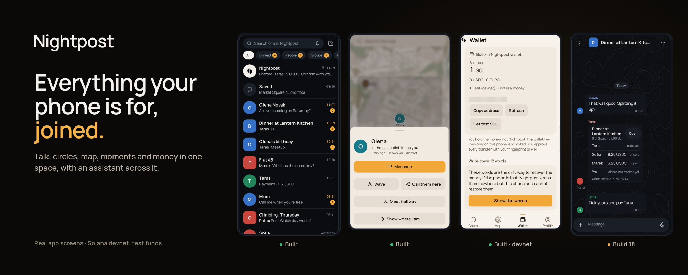
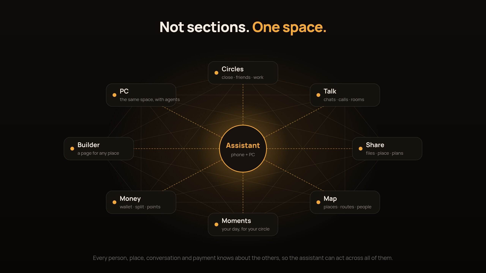
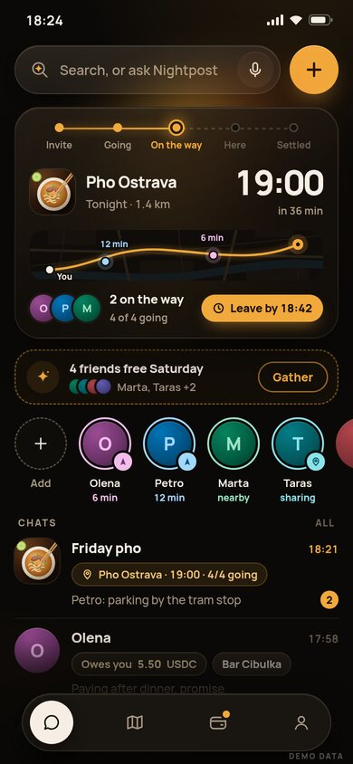
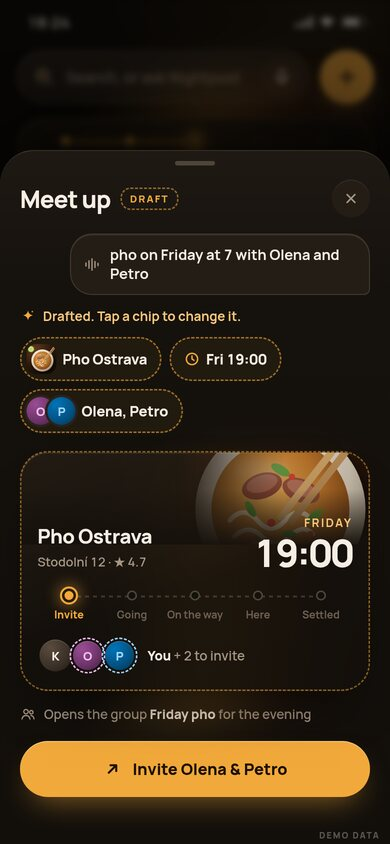
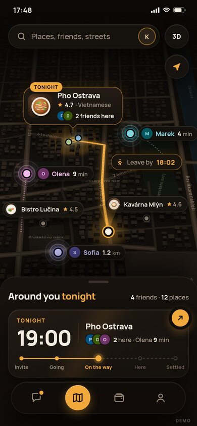
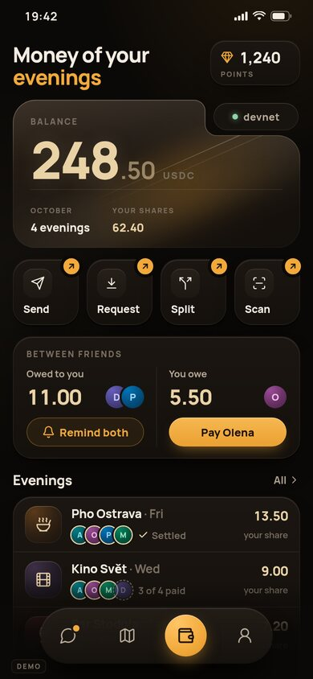
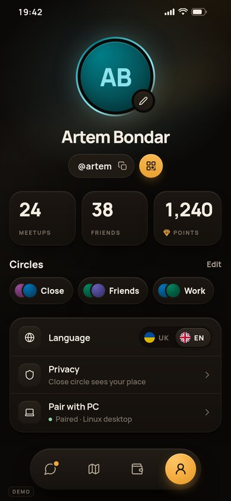

  

  <a href="https://phantom-os.dev"><b>Website</b></a> ·
  <a href="docs/nightpost-deck.pdf"><b>Deck (PDF)</b></a> ·
  <a href="https://phantom-os.dev/download"><b>Android build</b></a> ·
  <a href="#where-we-are-today"><b>Where we are today</b></a> ·
  <a href="mailto:hello@phantom-os.dev"><b>hello@phantom-os.dev</b></a>

  
  
  

---

## Your phone does five jobs in fifteen apps that never talk to each other

You talk to people. You share things with them. You sort them, whether you admit it or not, into close ones, friends, colleagues and everyone else. You find your way around a city. You show people your day.

Today each of those jobs lives in a different app. Your messenger doesn't know where your friends are. Your map doesn't know who you're meeting. Your bank doesn't know who you owe or why. Nothing knows your circles. So **you** are the glue: copying addresses, screenshotting locations, chasing money, retyping the same plan five times.

**Nightpost joins them into one space.** Your people, conversations, places, moments and money live together. An assistant can see how they fit, on your phone and on your PC.

  

## What lives in it

| | |
|---|---|
| **Circles** | Close, friends, work, social. Each circle sets who sees your place, your day and your status. No phone number is needed: a **@nickname**, a link or a QR adds anyone, anywhere. |
| **Talk** | Chats, voice notes, polls, calls and video in high quality, rooms that stay open for a team, and groups made for one event that dissolve or stay. |
| **Share** | Files, photos, contacts, plans and your live place, to one person, a group or a whole circle, for as long as you choose. |
| **Map** | A living map: places with real pages, friends who chose to be seen, routes, events nearby and when to leave. |
| **Moments** | Your day for the circle that should see it: a personal group, a diary, a feed for the people you actually know. |
| **Money** | A wallet inside the conversation: pay a friend, split a bill, request, chip in for a gift. Points for things you really did, spent on real gifts. |
| **Builder** | Any café, club, shop or organiser builds a page without code: menu, hours, bookings, orders with a pick-up time, events. |
| **Assistant** | It knows who, where, when and how much, so it can suggest, draft, remind and arrange. You always confirm. |
| **PC** | The same space on your computer, with agents that turn a call into tasks and a thread into a plan. |

## One day, many scenes

**09:40 · Work.** Marek's study group calls from a room that never closes. Someone drops the lab file into it. After the call, the assistant on his PC has already turned it into three tasks, one per person.

**13:10 · A new city.** Ana lands in Kraków. The map shows the places her circles rated, not ads. The assistant builds her afternoon around a 15:00 meeting. A photo of the market goes to her family circle, and only to them.

**16:30 · New in town.** Taras moved to Vienna for his studies three weeks ago. Events nearby, a climbing club with its own page, and people from his faculty who opted in: a city starts to feel like his.

**19:00 · Friends.** Lukáš picks a pho place. Four friends get one invite with a time, and a group opens for the evening. Everyone sees who's on the way. At the table, dishes split by person, and each pays their own share with a fingerprint. Nobody is the bank tonight.

**22:50 · Close ones.** Oksana's overnight bus is a dot on her daughter's map until 09:00, then the share ends by itself. "Home safe" goes out to her close circle without her typing it.

**Friday · The moment no single app can do.** It's Olena's birthday. The assistant sees that five of her close friends are free, that her favourite café has a table, and that a gift costs €10 each. It drafts all three. One tap from each friend, and it's done.

That last scene is the point. A messenger, a map or a bank can't do it alone, because each sees only a slice. Nightpost sees the people, the place, the time and the money together.

  
  
  
  
  
   Design preview of the next build. Demo data.

## Why Solana

Money between people is small, frequent and social. Five shares of one dinner, a €10 gift from six friends, a few points for showing up. That needs a chain where a transfer is cheap, final in seconds, and signed on the phone.

| | Why it matters here |
|---|---|
| **USDC and EURC** | People pay in dollars or euros they already hold, not a coin whose price moves while you pay. Both are legal to use in the EU under MiCA. |
| **Mobile Wallet Adapter and Seed Vault** | You sign with the wallet already on your phone. On a Seeker, the key never leaves its secure vault. |
| **The reference on chain** | Each share carries the id of the bill it pays, so the explorer shows what was paid for and one payment can never settle two shares. |
| **Points you can verify** | Points come only from actions backed by a real signature, not from a screen tap. |
| **Solana dApp Store** | A distribution channel built for this stack that reaches Seeker owners directly. |

## Business

People pay nothing. A place pays **€1–4 per guest who paid through Nightpost**. Its basic Builder page is free. We start with students in one university city (about 23,800 of them in Ostrava). Then the next campus, then Europe's 18.8 million students.

## Where we are today

The same honest status as on the website. Everything runs on Solana devnet, with zero users so far.

| Built and on the phone | Shipping in build 18 (12 Oct 2026) | Next |
|---|---|---|
| Messenger without a phone number: groups up to 32, voice notes, polls, reminders | @nicknames and global search; add anyone over the internet | Circles with their own visibility rules; call rooms |
| Friends on the map by consent, at a precision and time you choose; on-device navigation | Calls that ring, in high quality | Moments and the personal feed |
| One-to-one pay in chat: SOL, USDC, EURC, confirmed with a fingerprint | Meetup card with a group for the evening | Gifts, buying points, cashback funded by places |
| Wallet sign-in through MWA; Seeker Genesis Token check | Split by dish, each pays their share, bill id on chain | Assistant agents on the PC, shown once a real run is recorded |
| Phone–PC pairing and a messenger on the PC | Builder pages for places; points for real actions; the assistant works out of the box | Real money only after an independent security audit |

## How judges can verify

- **Devnet transactions.** Every payment claim runs on Solana's public test network and opens on Solana Explorer. [Early proof: a signed share cashed, and a copy of it refused.](https://explorer.solana.com/tx/5u377JHTiKakSqVdN3QB33qeQLUFxNBpx8vRmqAb83yRCHPRARt4XJWvqn9oZT3Pa1XYC5tH3sPrA9MdFBY9i3JT?cluster=devnet)
- **APK.** A free, signed Android build with its checksum is at [phantom-os.dev/download](https://phantom-os.dev/download).
- **Source on request.** The code is private during the review window. Judges can request read access through the website.

## Licence

© 2026 Kyrylo Myloserdov. **All rights reserved.** This repository holds only words, pictures and the pitch deck. No licence is granted to use them ([LICENSE](LICENSE)). The code is private.
