<p align="center">
  <picture>
    <source media="(prefers-color-scheme: dark)" srcset="docs/img/mark-dark.svg">
    
  </picture>
</p>

<h1 align="center">Nightpost</h1>

<p align="center">
  <b>Your people, places, plans and money — in one flow.</b><br>
  <sub>Encrypted conversations · Multi-profile life spaces · Vector map &amp; routing · Structured page Builder &amp; CRM · Instant USDC/EURC settlement on Solana</sub>
</p>

<p align="center">
  <a href="https://phantom-os.dev"></a>
  
  
  
  
</p>

> [!NOTE]
> **Primary Engineering Monorepo:** The complete active codebase for Nightpost (26 Android Gradle modules, React 18 web platform, and test suites) is developed at [**Kiril003/nightpost**](https://github.com/Kiril003/nightpost). This repository contains the Solana on-chain Anchor programs ([`solana-programs/`](solana-programs)), technical architecture documentation, and release artifacts.

<p align="center">
  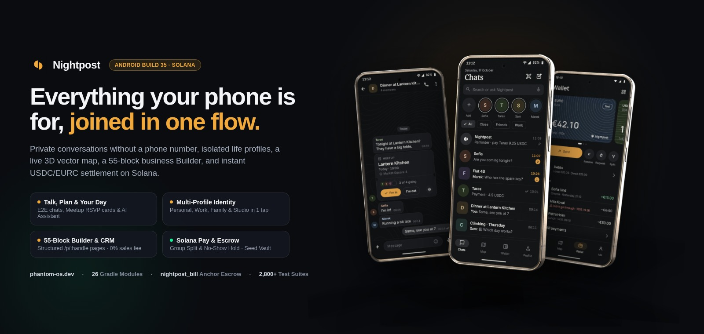
</p>

---

## Why Nightpost Exists

Going out with friends, running a local studio, or coordinating your day shouldn't force you across **six disconnected apps** — a messenger to talk, a map to find the venue, a browser to check hours or book a slot, a poll to agree on time, a notes app to track tasks, and a banking or split app to chase who owes what. At every hop, context leaks.

**Nightpost joins the entire loop into one private space:**
1. **Context stays in the conversation.** A meetup card, a live place sheet from the map, an itemized bill split, and an AI assistant live directly inside the chat thread.
2. **Real-world identity, not a single global dump.** You aren't the same person to your family, your clients, and your study group. Nightpost gives you **Circles** and **Multiple Life Profiles** (`Personal`, `Work`, `Family`, `Studio`, `Temporary`) with one-tap switching and separate inboxes.
3. **Every business page is structured data, not dead HTML.** With the built-in **Builder**, cafés, studios, creators, and schools publish pages where services, time slots, prices, and stock are typed fields — queryable by the assistant, pinned on the vector map, and connected straight to the owner's chat inbox as a zero-setup CRM.
4. **Social money that settles in seconds.** Split a group bill by dish, hold a booking deposit in an on-chain escrow vault (`nightpost_bill`), or send USDC/EURC directly inside a conversation — signed by your fingerprint in the Android Keystore or via Solana Mobile Seed Vault.

---

## Product Tour — Build 35 on Android

### 1. Conversations, Moments, and Your Day
No phone number or email required to start — people connect via cryptographic invites or `@handle` directory lookup. Conversations support E2E sealed envelopes, view-once photos (`FLAG_SECURE` hardware screenshot block), built-in photo markup editor, custom chat folders, conditional send (*"Send when online"* or scheduled recurring windows), voice/video calls with call privacy gates, Spaces (forums & channels), and audience-scoped **Moments**.

At the top of your chat list sits **Your Day** — pulling together your current schedule, upcoming plans, and promises automatically extracted from your conversations.

<table>
  <tr>
    <td align="center" width="25%">
      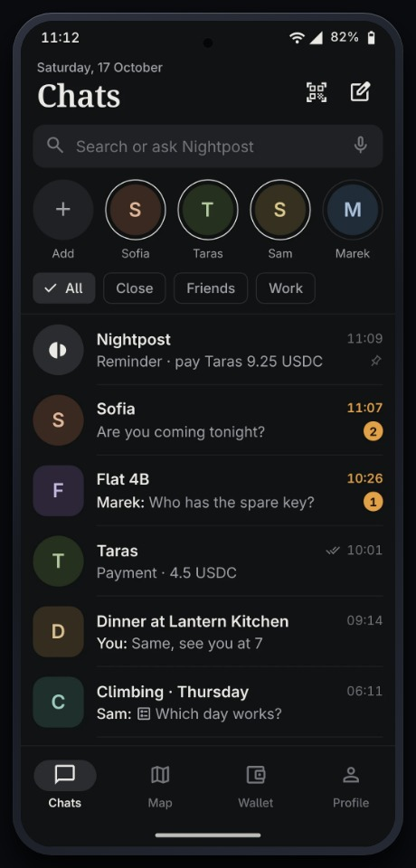<br>
      <sub><b>Chats &amp; Circles</b><br>Pinned reminders, Moments &amp; Circle tabs</sub>
    </td>
    <td align="center" width="25%">
      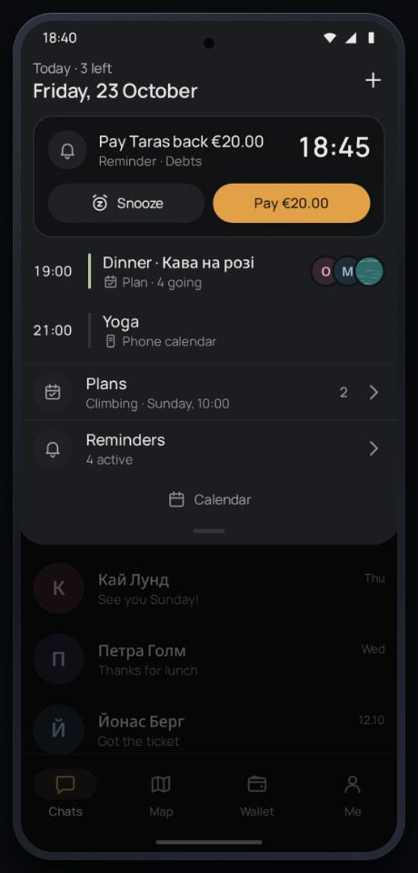<br>
      <sub><b>Your Day &amp; Debts</b><br>Schedule sheet, 1-tap debt pay &amp; plans</sub>
    </td>
    <td align="center" width="25%">
      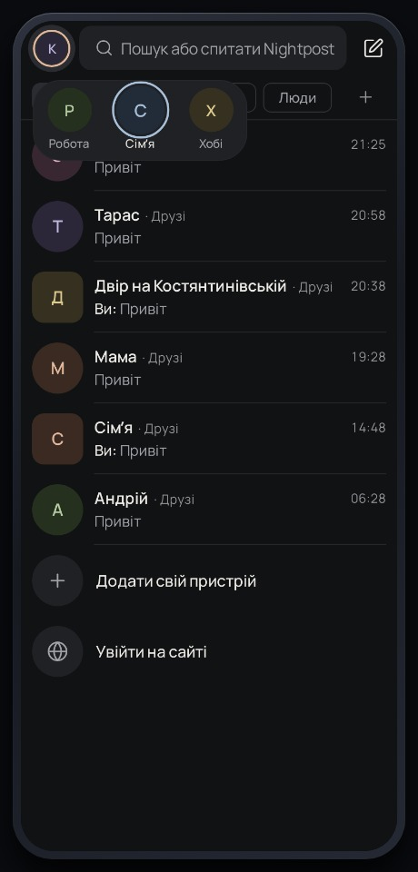<br>
      <sub><b>1-Tap Profile Fan</b><br>Switch Work, Family &amp; Hobby inboxes</sub>
    </td>
    <td align="center" width="25%">
      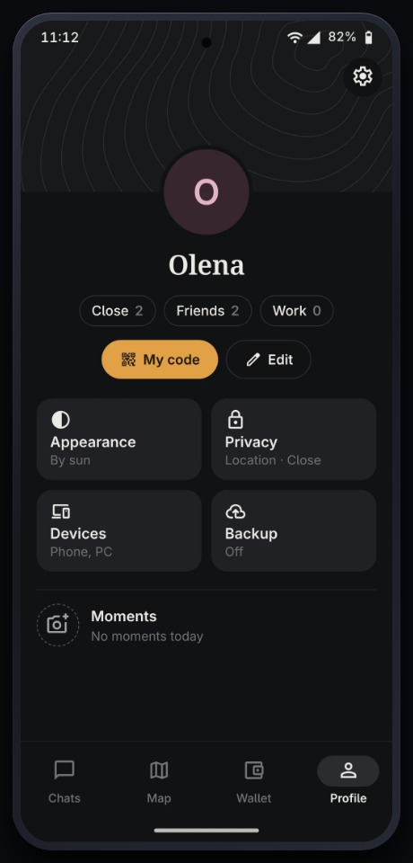<br>
      <sub><b>Identity &amp; Devices</b><br>Circles, QR code, privacy &amp; PC pairing</sub>
    </td>
  </tr>
</table>

### 2. Map, Routing, Meetup Plans, and the Assistant
Nightpost ships its own **OpenStreetMap 3D vector map** and on-device/OSRM routing engine (`core-geo`, `core-nav`, `core-mobility`) with 3D extruded buildings, downloadable offline city packs, public transit timetables (GTFS), road closures with arrival-time impact, parking prices, and Android Auto support.

Tap any venue on the 3D map to open its live **Place Dossier**, drop a **Meetup Card** (*"I'm in / I'm out"*) into a group chat, or ask the **Nightpost Assistant** to summarize unread messages, find a free evening slot, or draft a split. The assistant drafts actions; only your tap or fingerprint executes them.

<table>
  <tr>
    <td align="center" width="25%">
      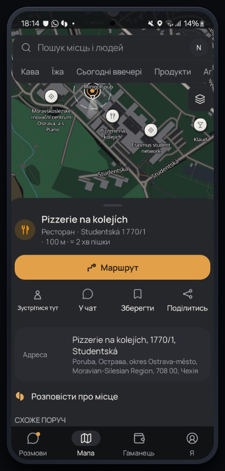<br>
      <sub><b>3D Map &amp; Place Dossier</b><br>Live 3D buildings, distance &amp; meet-here</sub>
    </td>
    <td align="center" width="25%">
      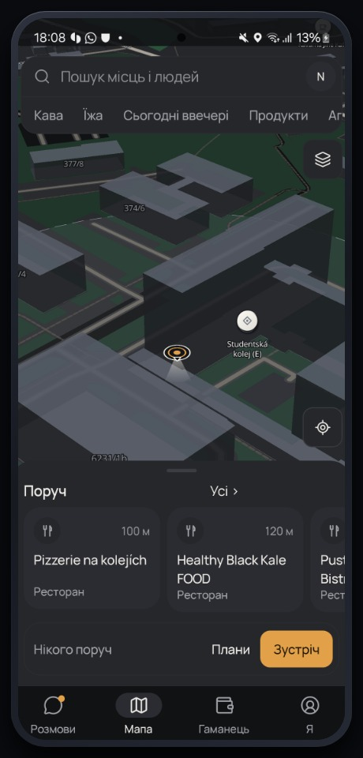<br>
      <sub><b>3D Vector City Map</b><br>Extruded buildings, venues &amp; offline packs</sub>
    </td>
    <td align="center" width="25%">
      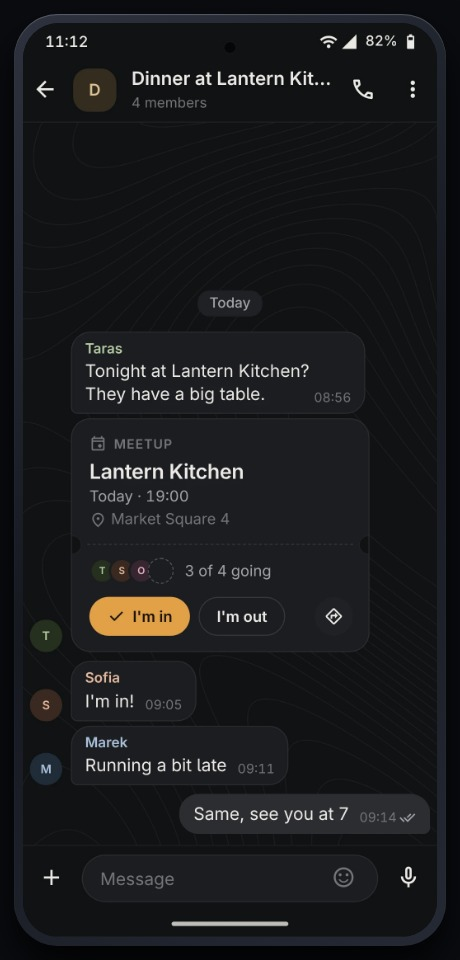<br>
      <sub><b>Meetup Card in Chat</b><br>Venue, time, 1-tap RSVP &amp; route</sub>
    </td>
    <td align="center" width="25%">
      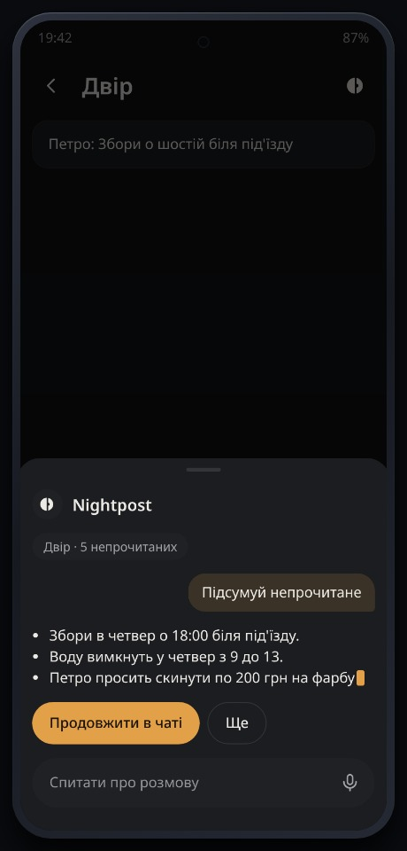<br>
      <sub><b>Ask Nightpost</b><br>Unread digest, schedule &amp; chat actions</sub>
    </td>
  </tr>
</table>

### 3. Builder: Structured Web + App Pages & Chat-Native CRM
Unlike Linktree, Wix, or Instagram bios that trap business information in unstructured text or images, **Builder** turns every local venue, studio, creator, or school into a **structured node**:
- **55+ modular blocks** across *Sell, Book, Classes, Hiring, Delivery, Talk, Pay, and Place* — editable in **Canvas** or **Pro** mode on both desktop (`phantom-os.dev/build`) and mobile.
- **AI Page Generator:** Describe your business, attach photos and a price sheet, and get a ready-to-publish structured page in seconds.
- **Chat = CRM:** When a customer books a time slot or asks a question on `/p/:handle`, it lands directly in the owner's Nightpost chat inbox with shift-scoped staff controls.

<p align="center">
  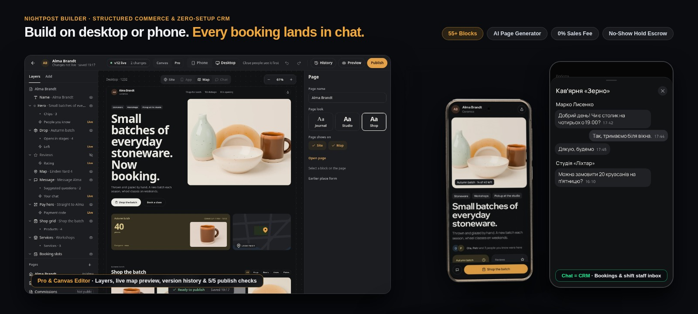
</p>

<table>
  <tr>
    <td align="center" width="25%">
      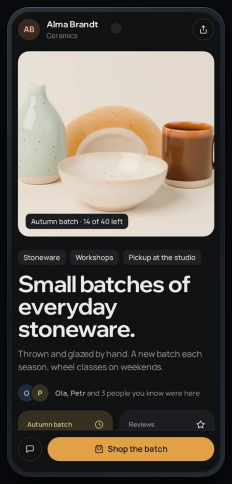<br>
      <sub><b>Live Studio Page (`/p/alma`)</b><br>Batch stock counter, social proof &amp; shop</sub>
    </td>
    <td align="center" width="25%">
      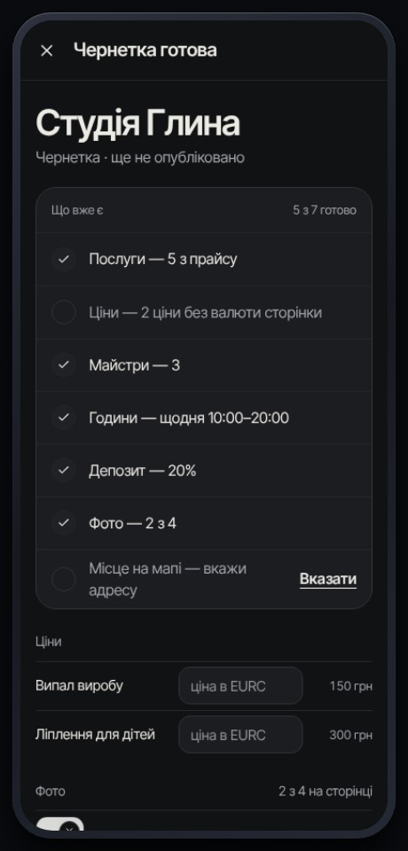<br>
      <sub><b>AI Page Readiness</b><br>Services, 20% deposit &amp; EURC price check</sub>
    </td>
    <td align="center" width="25%">
      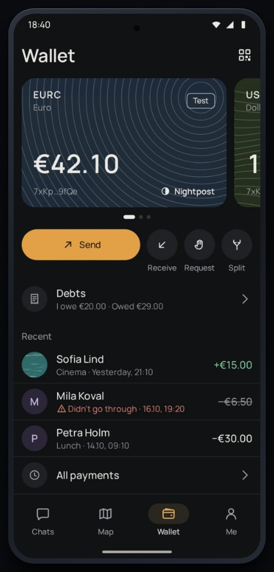<br>
      <sub><b>EURC &amp; USDC Wallet</b><br>Topographic cards, Debts &amp; 1-tap Split</sub>
    </td>
    <td align="center" width="25%">
      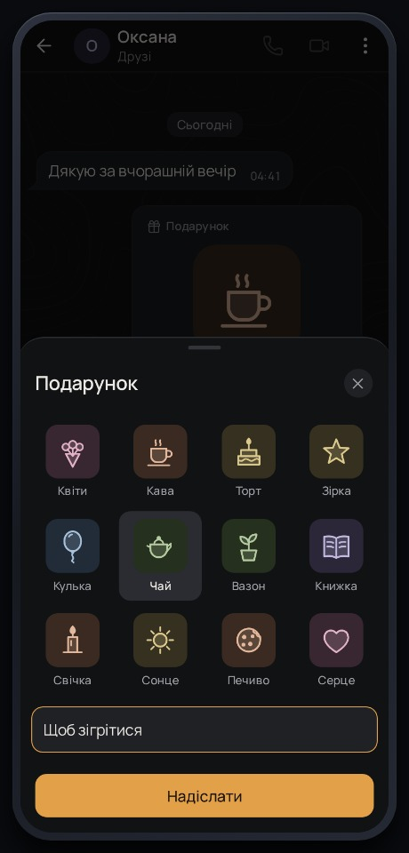<br>
      <sub><b>In-Chat Gift Picker</b><br>Send a warm note or gift inside any chat</sub>
    </td>
  </tr>
</table>

### 4. Solana Money, Escrow (`nightpost_bill`), Points & 3D Gifts
Money between people and local venues is small, frequent, and social. Nightpost uses Solana (currently **devnet** by default; mainnet sits behind an explicit operator & user gate) so transfers settle in seconds for `$0.0005`:
- **Non-Custodial Keystore & Seed Vault:** Built-in wallet with Ed25519 keys protected by Android Keystore biometrics, plus full **Mobile Wallet Adapter (MWA)**, **Seed Vault**, and **Seeker Genesis Token (SGT)** recognition.
- **Gasless Fee Sponsor (`sponsor.py` / `Sponsor.kt`):** The server co-signs as fee payer so users only need USDC or EURC — never SOL for gas.
- **On-Chain Anchor Program (`solana-programs/programs/nightpost_bill`):** Native Rust/Anchor escrow program supporting two modes on SPL tokens:
  - `Split` mode (1–16 shares): Group bill escrow where shares sit in a PDA vault and auto-settle to the payee when the last share is paid (or refund if cancelled/expired).
  - `Hold` mode: Single-buyer booking deposit escrow with a configurable cancellation `cutoff` and optional `forfeit_allowed` protection against no-shows.
- **Activity Points & 3D Gifts:** Users earn points for real activity (meetups, first transfers, invites), signed by an isolated claims key (`ClaimKeyStore`), and redeem them in the in-app 3D Gift & Sticker Store.

<p align="center">
  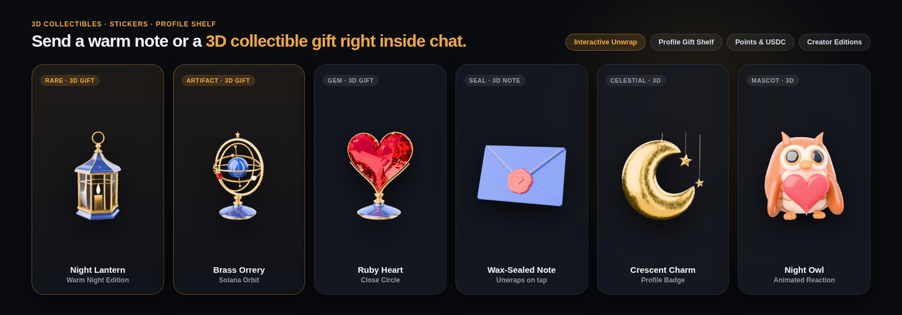<br>
  <sub><b>In-App 3D Gifts &amp; Stickers</b> · Interactive unwrap in chat, profile gift shelf, and creator editions</sub>
</p>

---

## How Nightpost Compares

| Capability | Telegram / WhatsApp | Google Maps + Linktree | Revolut / Splitwise | **Nightpost** |
|---|---|---|---|---|
| **Identity & Privacy** | Phone number required; one global profile | Public web / Google account | Full KYC bank account | **No phone number required · Multiple isolated profiles &amp; Circles** |
| **Group Planning** | Text polls buried in scroll | Share static links back and forth | Manual IOUs after the fact | **Live Meetup Card + Map pin + Itemized USDC split in one thread** |
| **Local Business Pages** | Unstructured channel posts or bots | Static links; 3rd-party booking fees | Payment links only | **Structured Builder (`/p/:handle`) + 0% fee + Bookings land in chat** |
| **AI Assistant** | Separate chatbot threads | Keyword search only | Support bot | **Cross-surface Assistant (chats, map, calendar, Builder, wallet drafts)** |
| **Payments & Escrow** | Platform-locked stars or 3rd-party bots | None | Fiat rails, no programmable escrow | **Self-custodial USDC/EURC + On-chain Split &amp; No-Show Hold Escrow** |

---

## Who Nightpost Is For & Business Model

Nightpost operates as a **two-sided network**: everyday people and groups use the entire messenger, map, and wallet **for free** (creating organic local demand and viral group loops), while solo professionals, venues, and teams pay a simple flat subscription to run their business inside that same flow.

### 1. Customer Segments & Problems Solved

| Segment | The Problem Today | What Nightpost Gives Them |
|---|---|---|
| **Everyday People & Friend Groups (B2C · Free)** | Planning one evening takes 6 apps (chat, map, browser, poll, notes, bank app). **46%** of people owed money after a group outing never chase it back because it feels awkward. And phone-number messengers dump family, boss, and strangers into one profile. | **One thread for the whole plan:** drop a place from the vector map, vote on a Meetup Card, and split the bill by dish in USDC inside the group chat — while keeping **Personal, Work, and Family** identities in separate profiles. |
| **Solo Professionals & Creators (`Studio`)** | Barbers, beauty masters, tutors, trainers, and indie makers pay for Linktree/Wix + Calendly/Fresha + 2–3% card fees while manually answering DMs across 4 apps. | **Structured page (`/p/:handle`) in 60 seconds:** AI generates a booking/shop page from photos and a price sheet; client bookings and questions arrive straight in the Nightpost chat inbox (`Chat = CRM`) with **0% commission on sales**. |
| **Physical Venues, Teams & Schools (`Place`)** | Cafés, studios, workshops, and local schools suffer from costly **no-shows**, fake unverified web reviews, and complex multi-seat CRM software. | **On-chain no-show deposits (`Hold` escrow):** lock a refundable booking deposit with a cutoff time, issue shift-scoped staff passes (`+€3/staff`), get pinned on the city map, and accept reviews verified by real payment receipts. |

### 2. How Nightpost Makes Money

**People never pay to talk, coordinate plans, or send money to friends — and Nightpost takes 0% cut from business sales.** Revenue comes from four transparent streams:

1. **B2B SaaS Subscriptions (`Studio` & `Place` Plans):**
   - **Personal (`€0 / forever`):** Full encrypted messenger, multi-profiles & Circles, vector map & routing, self-custodial wallet, P2P transfers, and a personal page.
   - **Studio (`€9 / month`):** For solo masters, creators, and freelancers — all 55+ structured Builder blocks (booking slots, catalog, classes), AI page generator, customer requests in chat, and extended AI assistant limits.
   - **Place (`€19 / month` + `€3 / month` per extra staff member):** For physical venues, multi-staff studios, and schools — team shift passes with granular permissions, map venue pin, no-show deposit holds (`nightpost_bill`), and CRM analytics. *(All plans are free during the launch window through 31 Dec 2026).*
2. **24/7 AI Business Receptionist (Add-On):**
   Because every Builder page stores structured fields (exact hours, services, prices, free slots, allergens) rather than dead HTML text, the Nightpost Assistant can act as a **24/7 digital employee** — answering customer questions accurately and booking open slots automatically without human intervention.
3. **Consumer Micro-Transactions (3D Gifts & Look Packs):**
   Paid 3D collectible gifts, custom sticker packs, and profile Look themes purchased in-app (via Google Play Billing or earned/topped-up points) to send inside conversations and Moments.
4. **Financial & Wallet Rails:**
   Zero platform fee on P2P transfers, group bill splits, and merchant checkouts; small spread/service fee only on optional in-wallet token swaps and fiat on/off-ramp conversions.

---

## System Architecture

Nightpost is engineered as a **five-part monorepo** where the native Android shell owns cryptography, storage, sensors, map rendering, and wallet signing, while the embedded React messenger and web platform share a strict design and type contract.

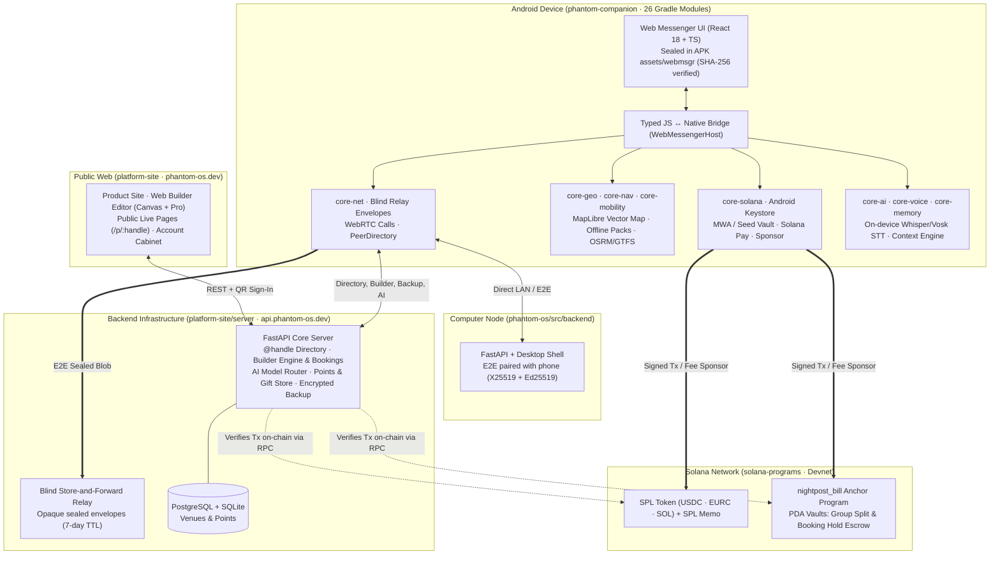

Deep-dive documentation:
- **[`docs/ARCHITECTURE.md`](docs/ARCHITECTURE.md)** — Module breakdown, phone-to-relay envelope flow, and server subsystems.
- **[`docs/SECURITY.md`](docs/SECURITY.md)** — Threat boundaries, hardware-backed keystore isolation, blind relay guarantees, and bundle sealing.
- **[`docs/DEVELOPMENT.md`](docs/DEVELOPMENT.md)** — Build instructions, `gate.sh` test runner, web bundle seal workflow, and release pipeline.
- **[`docs/brand/BRAND.md`](docs/brand/BRAND.md)** — Brand identity, *"Warm Night / Deep Ink"* token specification (`#0A0C10` canvas, `#F2A93B` amber accent), and typography.

---

## Repository Map

| Directory | Component | Tech Stack & Scope |
|---|---|---|
| [`phantom-companion/`](https://github.com/Kiril003/nightpost/tree/main/phantom-companion) | **Android Application** | Kotlin 2.0, Jetpack Compose, Gradle 8.11, AGP 8.7, `targetSdk 36`, `minSdk 29`. **26 modules** (`app` with `field`/`store` flavors, 18 `core-*` modules, 6 `feature-*` modules, `wear`) |
| [`phantom-os/src/frontend/`](https://github.com/Kiril003/nightpost/tree/main/phantom-os/src/frontend) | **Messenger & App UI** | React 18, TypeScript strict, Vite 5, Tailwind/Design Tokens. Compiles to `dist-phone` and ships inside the APK (`assets/webmsgr`) with a cryptographic SHA-256 build seal |
| [`phantom-os/src/backend/`](https://github.com/Kiril003/nightpost/tree/main/phantom-os/src/backend) | **Computer Node & AI Runtime** | Python 3.11, FastAPI, SQLAlchemy 2 async, ChromaDB, multi-tier STT/TTS voice pipeline, local/cloud AI router, paired E2E with the phone |
| [`platform-site/`](https://github.com/Kiril003/nightpost/tree/main/platform-site) | **Web Platform & Builder** | React + Vite (`src/`): `phantom-os.dev` marketing site, 55-block Builder editor (`Canvas` & `Pro`), public `/p/:handle` venue renderer, user cabinet |
| [`platform-site/server/`](https://github.com/Kiril003/nightpost/tree/main/platform-site/server) | **Cloud API & Blind Relay** | Python 3.11, FastAPI, PostgreSQL: `@handle` directory, blind envelope relay, Builder API & bookings, fee sponsor (`sponsor.py`), points & 3D gift store, encrypted backup vault, support desk |
| [`solana-programs/`](solana-programs) | **On-Chain Escrow Program** | Rust, Anchor (`nightpost_bill`), LiteSVM integration tests: PDA-based group bill `Split` (up to 16 shares) and booking deposit `Hold` with cutoff/forfeit rules |

*Note: Internal package names and directory paths retain the early engineering codename `phantom`; the user-facing product and brand is **Nightpost**.*

---

## Engineering Discipline & Verification Gates

Nightpost is built under strict, automated engineering invariants (~1.09M lines of code across ~2,800 test files):

1. **Cryptographic Web Bundle Seal (`verify<Variant>WebBundleSeal`):**
   The React messenger inside the APK (`app/src/main/assets/webmsgr`) is never edited by hand. [`sync_web_messenger.sh`](https://github.com/Kiril003/nightpost/blob/main/phantom-companion/scripts/sync_web_messenger.sh) builds `build:phone` from a **clean git tree** of the target commit and writes `BUNDLE_SOURCE` containing `web_sha` and `content_sha256`. Gradle verifies this hash on every APK/AAB build and refuses to package an unsealed or drifted bundle.
2. **Zero-Tolerance Test Gate (`scripts/gate.sh`):**
   [`gate.sh`](https://github.com/Kiril003/nightpost/blob/main/phantom-companion/scripts/gate.sh) acquires a machine `flock`, clears stale configuration caches, runs unit/Robolectric tests, and parses **fresh JUnit XML reports**. A module with zero executed tests or a stale XML timestamp fails the gate even if Gradle prints `BUILD SUCCESSFUL`.
3. **No Invented UI or Silent Fallbacks:**
   Every screen implements explicit Empty, Loading, Error, and Offline states. No API keys, model names, or provider secrets are ever compiled into the APK.
4. **On-Chain Truth Verification:**
   The backend never trusts client-reported payment statuses; it fetches and verifies finalized SPL Token and `nightpost_bill` transactions directly from Solana RPC nodes.

---

## Quick Start: Build & Test

### 1. Android App (`phantom-companion`)
Requires JDK 17 and Android SDK 34/36.
```bash
cd phantom-companion

# Run the verification gate on app flavors (field + store)
bash scripts/gate.sh :app:testFieldDebugUnitTest :app:testStoreDebugUnitTest

# Run Solana wallet & escrow unit tests
bash scripts/gate.sh :core-solana:testDebugUnitTest

# Assemble the debug APK (verifies the webmsgr SHA-256 seal automatically)
bash scripts/gate.sh :app:assembleFieldDebug
```

### 2. Messenger UI (`phantom-os/src/frontend`)
```bash
cd phantom-os/src/frontend
npm ci
npx vitest run          # Unit & component test suite
npm run typecheck       # Strict TypeScript check (tsc --noEmit)
npm run build:phone     # Production bundle for Android WebView
```

### 3. Platform Site, Builder & Cloud Server (`platform-site`)
```bash
cd platform-site
npm ci && npm run typecheck && npm run build

cd server
python3 -m pytest tests/ -q
```

### 4. Solana Escrow Program (`solana-programs`)
```bash
cd solana-programs
anchor build
cargo test --test escrow
```

---

## License

Proprietary — © 2026 Kyrylo Myloserdov. All rights reserved. See [LICENSE](LICENSE).
