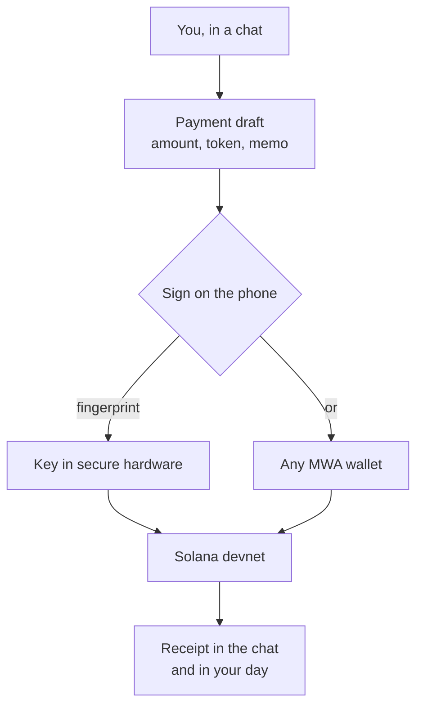

  <picture>
    <source media="(prefers-color-scheme: dark)" srcset="docs/img/mark-dark.svg">
    
  </picture>

<h1 align="center">Nightpost on Solana</h1>

  <b>Money that lives where your people already are.</b> 
  Nightpost is everything a phone is for, in one space: talk and share, people in circles, the map, your day, places and organisers. 
  Solana is how money, points and gifts move inside it.

  <a href="https://phantom-os.dev"><b>phantom-os.dev</b></a> &nbsp;·&nbsp;
  <a href="https://phantom-os.dev/download"><b>Download for Android</b></a> &nbsp;·&nbsp;
  <a href="https://github.com/Kiril003/nightpost"><b>The whole product</b></a>

  
  
  

<table>
  <tr>
    <td align="center" width="25%"> <b>Wallet</b></td>
    <td align="center" width="25%"> <b>In a chat</b></td>
    <td align="center" width="25%"> <b>Debts</b></td>
    <td align="center" width="25%"> <b>Deposits</b></td>
  </tr>
</table>

Screens from the Android app on a real phone. Names and places are test data. All money is devnet test funds.

---

## Why Solana

Money between friends and small places is small, frequent and social. It should move as fast as a message, cost less than a cent, and need no bank account to start. Solana makes that possible inside a chat, a plan or a booking.

## What works today

All money runs on **devnet**, with test funds. Mainnet stays off until an independent review.

| What | In plain words | Status |
| --- | --- | --- |
| Wallet | A key in the phone's secure hardware behind your fingerprint, or any wallet app through Mobile Wallet Adapter (MWA) with Sign In With Solana | Works on devnet |
| Pay in a chat | USDC and EURC as SPL tokens, SOL as a plain transfer, each with a memo that ties it to the chat | Works on devnet |
| Pay links and QR | Solana Pay requests that any wallet can open | Works on devnet |
| Signed cash | A payment signed now and sent to the network later. A durable nonce makes any second copy fail. [See one on devnet](https://explorer.solana.com/tx/5u377JHTiKakSqVdN3QB33qeQLUFxNBpx8vRmqAb83yRCHPRARt4XJWvqn9oZT3Pa1XYC5tH3sPrA9MdFBY9i3JT?cluster=devnet) | Works on devnet |
| Seeker | Finds Seed Vault on the device and reads the Seeker Genesis Token | Read-only |
| Escrow for bills and bookings | An on-chain program, explained below | Written and tested, not yet deployed |
| No SOL for fees | Our server can pay the network fee for USDC and EURC transfers | Built, not switched on |

## The escrow program, in plain words

It has two jobs.

1. **Split a bill.** Each person's share waits in a vault that only the program controls. When the last share arrives, the whole sum goes to the person who paid. If the bill is cancelled or runs out of time, every share goes back to whoever sent it. Up to sixteen people per bill.
2. **Hold a booking deposit.** A guest's deposit waits until the visit. Cancel before the place's cutoff and it comes back. If the place allows it, a no-show's deposit goes to the place.

The rules are written into the program, so no person decides where a share goes. Its tests cover each path: paid in full, cancelled, expired, refunded in time, a no-show, and every attempt to pay or refund twice.

## How a payment moves

- Keys never leave the phone. Nightpost never holds your money.
- The assistant can draft a payment, but only your fingerprint or your wallet sends it.
- Every payment carries a memo, so the receipt lands back in the right chat.

## Devnet addresses the app uses

| Token or program | Address |
| --- | --- |
| USDC | [4zMMC9…DncDU](https://explorer.solana.com/address/4zMMC9srt5Ri5X14GAgXhaHii3GnPAEERYPJgZJDncDU?cluster=devnet) |
| EURC | [HzwqbK…KtDr](https://explorer.solana.com/address/HzwqbKZw8HxMN6bF2yFZNrht3c2iXXzpKcFu7uBEDKtr?cluster=devnet) |
| Memo | [MemoSq…cHr](https://explorer.solana.com/address/MemoSq4gqABAXKb96qnH8TysNcWxMyWCqXgDLGmfcHr?cluster=devnet) |

## Next

1. An independent review of the wallet and the escrow program.
2. Deploy the escrow program to devnet and switch on fee sponsoring.
3. Mainnet, only after both.

---

## Get it

- **Android 10 or newer:** [phantom-os.dev/download](https://phantom-os.dev/download)
- **The whole product:** [Kiril003/nightpost](https://github.com/Kiril003/nightpost)

## Licence

Proprietary, all rights reserved. See [LICENSE](LICENSE).
