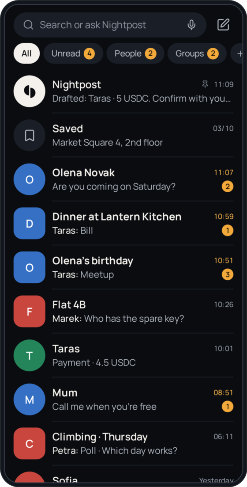
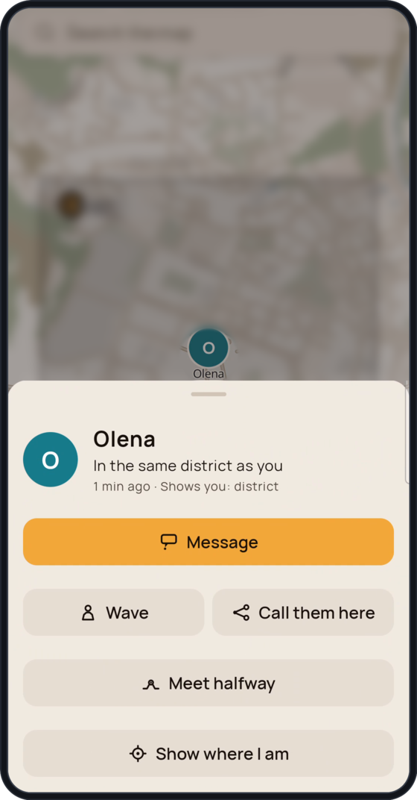
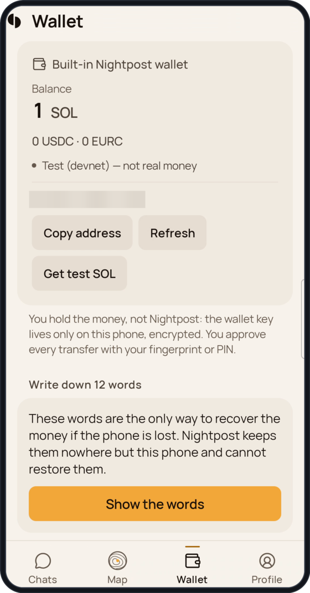
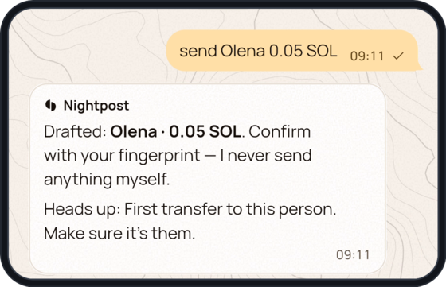
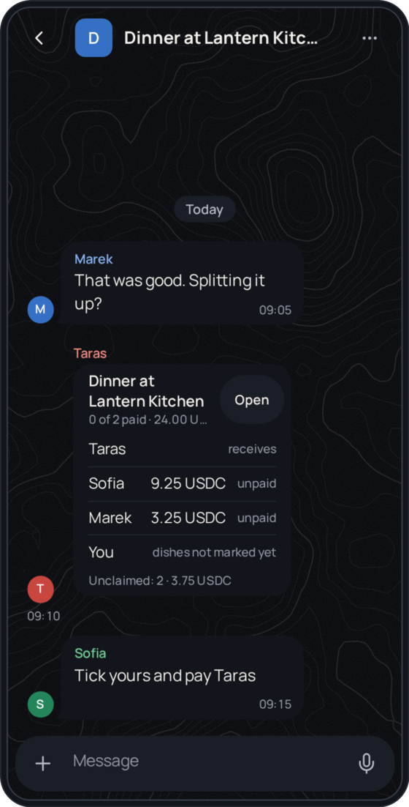
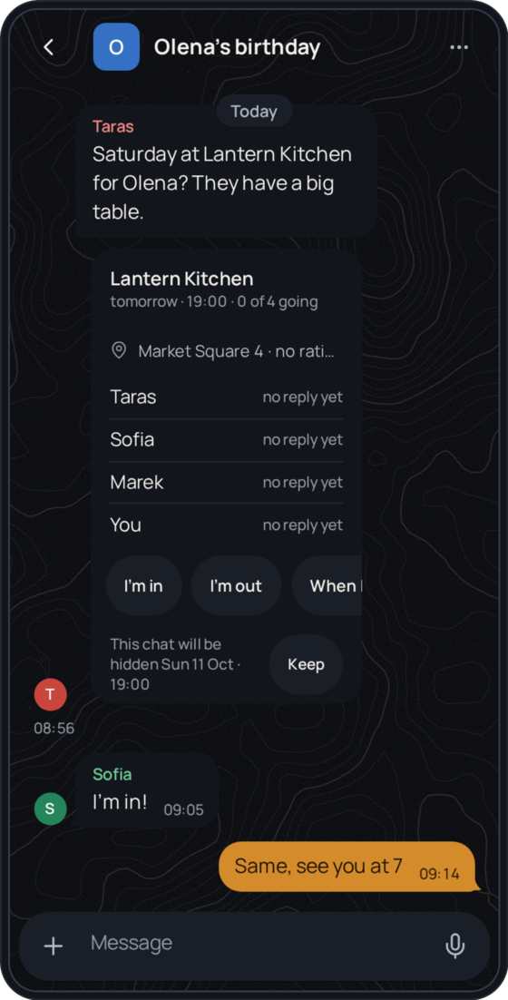

  <picture>
    <source media="(prefers-color-scheme: dark)" srcset="docs/img/mark-dark.svg">
    
  </picture>
   <b>Nightpost</b>

  

  <a href="https://phantom-os.dev"><b>Website</b></a> ·
  <a href="docs/nightpost-deck.pdf"><b>Deck (PDF)</b></a> ·
  <a href="https://phantom-os.dev/download"><b>Android build</b></a> ·
  <a href="#where-we-are-today"><b>Where we are today</b></a>

  
  
  

---

## The jobs of your phone work better joined

You talk, share, sort people into circles, find your way, show your day and pay. Today each job sits in a different app, and you carry the context between them by hand.

**Nightpost joins them into one space:** people, conversations, places, moments and money together, with an assistant that sees how they fit, on your phone and on your PC.

  
   Product map. Status of each part is in the table below.

## What lives in it, and where each part stands

Status: **Built** runs on the phone today. **Build 18** is in progress. **Next** is planned, not started.

| | What it is | Status |
|---|---|---|
| **Circles** | Close, friends, work. Each circle sets who sees your place, your day and your status. | Next |
| **Talk** | Chats without a phone number, groups up to 32, voice notes, polls, reminders. Calls that ring, in high quality. | Built · calls in Build 18 |
| **Share** | Your live place to the people you choose, at a precision and for a time you choose. | Built |
| **Map** | Friends who chose to be seen, on-device navigation. Places with real pages come with Builder. | Built · places in Build 18 |
| **Moments** | Your day for the circle that should see it. | Next |
| **Money** | Pay a friend inside the chat. Split by dish with each paying their share, and points for real actions. | Pay built · split and points in Build 18 · gifts Next |
| **Builder** | A page for any café, club or shop, without code. | Build 18 |
| **Assistant** | It sees who, where, when and how much, then suggests, drafts and reminds. You always confirm. | Payment drafts built · the rest Build 18 |
| **PC** | The same space on your computer: messenger first, agents later. Not released yet. | Next |

## On the phone

<table>
  <tr>
    <td align="center" valign="top" width="33%">
       
      <b>Chats</b> · Built Demo names
    </td>
    <td align="center" valign="top" width="33%">
       
      <b>Map</b> · Built Captured on a phone, map blurred
    </td>
    <td align="center" valign="top" width="33%">
       
      <b>Wallet</b> · Built, devnet Captured on a phone, test funds
    </td>
  </tr>
  <tr>
    <td align="center" valign="top" width="33%">
       
      <b>Assistant</b> · Built for payment drafts Captured on a phone, test funds
    </td>
    <td align="center" valign="top" width="33%">
       
      <b>Split the bill</b> · Build 18 Build 18 interface, demo names
    </td>
    <td align="center" valign="top" width="33%">
       
      <b>Meetup card</b> · Build 18 Build 18 interface, demo names
    </td>
  </tr>
</table>

Real screens of the app, nothing mocked up. Map, wallet and assistant were captured on a phone with test funds; the map is blurred for privacy. Chats, split and meetup show the build 18 interface with invented names and a made-up place.

## Why Solana

Money between people is small, frequent and social. That needs a chain where a transfer is cheap, final in seconds and signed on the phone.

| | Why it matters here | Status |
|---|---|---|
| **USDC and EURC** | People pay in dollars or euros they already hold, not a coin whose price moves while they pay. | Built (devnet) |
| **Mobile Wallet Adapter and Seed Vault** | You sign with the wallet already on your phone. On a Seeker, the key stays in its secure vault. | Built |
| **The reference on chain** | Each share carries the id of the bill it pays, so the explorer shows what was paid for. | Build 18 |
| **Points you can verify** | Points come only from actions backed by a real signature. | Build 18 |
| **Solana dApp Store** | A distribution channel built for this stack. | Next |

## Solana Mobile stack

Nightpost is built for Seeker. Wallet, identity and SKR live inside the chat.

| | What it does | Status |
|---|---|---|
| **Mobile Wallet Adapter** | External wallets connect through MWA. Keys stay in the wallet. | Built |
| **Seeker verified** | Sign in with Solana. Our server checks the Seeker Genesis Token on mainnet and signs a "Seeker verified" mark. The Genesis Token also unlocks one month of Pro. | Build 19 |
| **SKR stake tier** | Payment cards show the mark with the stake tier: staker, 1k+ or 10k+ SKR. Friends' phones check the signature themselves. | Build 19 |
| **SKR payments** | SKR works as a payment token in chat, on mainnet only. Devnet has no SKR. | Build 19, mainnet only |
| **Solana dApp Store** | Publisher KYC is done. The listing is the next milestone. | Next |

## Where we are today

The same status as on the website. Everything runs on Solana devnet with test funds.

| Built and on the phone | Build 18 (in progress) | Next |
|---|---|---|
| Messenger without a phone number: groups up to 32, voice notes, polls, reminders | @nicknames and global search; add anyone over the internet | Circles with their own visibility rules; call rooms |
| Friends on the map by consent, at a precision and time you choose; on-device navigation | Calls that ring, in high quality | Moments and the personal feed |
| One-to-one pay in chat: SOL, USDC, EURC, confirmed with a fingerprint | Meetup card with a temporary group | Gifts, buying points, cashback funded by places |
| Wallet sign-in through MWA; Seeker Genesis Token check | Split by dish, each pays their share, bill id on chain | The space on your PC, then assistant agents there, shown once a real run is recorded |
| The assistant drafts a payment from one sentence | Builder pages for places; points for real actions; the assistant works out of the box | Real money only after an independent security audit |

## Architecture

  
   How the parts fit. Circles, the PC and agents are not shipped yet; the status table above is the source of truth.

## How judges can verify

- **Devnet transactions.** Every payment claim runs on Solana's public test network and opens on Solana Explorer. [Early proof: a token transfer confirmed on devnet at slot 506,800,570 on 02 Oct.](https://explorer.solana.com/tx/5u377JHTiKakSqVdN3QB33qeQLUFxNBpx8vRmqAb83yRCHPRARt4XJWvqn9oZT3Pa1XYC5tH3sPrA9MdFBY9i3JT?cluster=devnet)
- **APK.** A free, signed Android build with its checksum is at [phantom-os.dev/download](https://phantom-os.dev/download). The release plan is in [docs/RELEASES.md](docs/RELEASES.md).
- **Source code.** The code is in a private repository. Judges get access through the hackathon platform's GitHub App (the platform makes a private judging copy and the source stays private), or on request through the website.

## Licence

© 2026 Kyrylo Myloserdov. **All rights reserved.** This repository holds only words, pictures and the pitch deck. No licence is granted to use them ([LICENSE](LICENSE)). The code is private.
