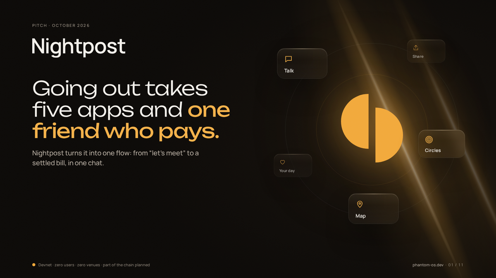
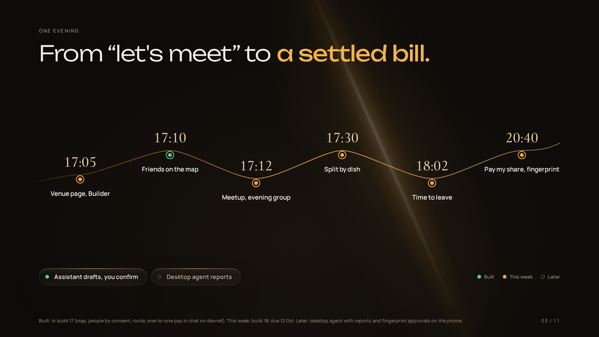
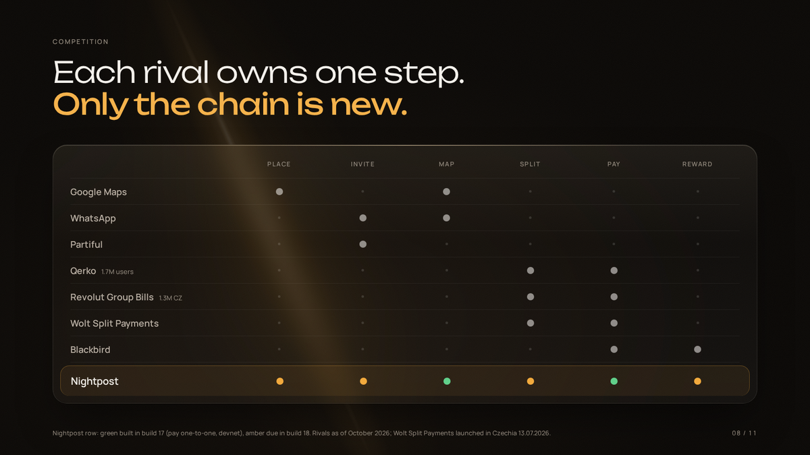

  

<h3 align="center">Going out takes five apps and one friend who pays. Nightpost turns it into one flow.</h3>

From "let's meet" to a settled bill, in one chat.

  <a href="https://phantom-os.dev"><b>Website</b></a>
  &nbsp;·&nbsp;
  <a href="docs/nightpost-deck.pdf"><b>Pitch deck (PDF)</b></a>
  &nbsp;·&nbsp;
  <a href="https://colosseum.com/arena/projects/nightpost"><b>Colosseum project</b></a>
  &nbsp;·&nbsp;
  <a href="https://phantom-os.dev/download"><b>Download for Android</b></a>

Devnet only · zero users · zero venues today · part of the chain is still planned

  <a href="#one-evening-one-flow">One evening, one flow</a> ·
  <a href="#built-this-week-later">Built · this week · later</a> ·
  <a href="#why-solana">Why Solana</a> ·
  <a href="#three-evenings">Three evenings</a> ·
  <a href="#team">Team</a> ·
  <a href="#how-judges-can-verify">How judges can verify</a>

 

## Five apps, and one friend pays for everyone

A group deciding where, when and who's coming goes through Google Maps, a group chat, a poll tool, a location screenshot and a split-the-bill app — in that order, every time.

| | | |
|---|---|---|
| **83 messages, ~11 days** | to plan one trip | Talker Research 2026 |
| **76%** | of group trips never happen | Talker Research 2026 |
| **46%** | too awkward to ask for the money back | Starling, UK 2023 |
| **~30%** | of a delivery order the venue loses to commission | Wolt CZ, 13.07.2026 |

A phone already does five jobs an evening needs: talk, share a place, keep your circles, find your way, share your day. Nightpost joins them into one flow instead of five apps.

## One evening, one flow

Five stages, one card that changes as the evening moves — never a new message per step.

1. **Invite.** A venue's page, built by its owner with no code, and a time go out as one card to the people invited. *This week.*
2. **Going.** Anyone sharing their position shows up on the map; avatars fill in as each friend answers. *Map sharing built; the invite card is this week.*
3. **On the way.** The map tells each person when to leave; friends' dots move toward the venue. *Built.*
4. **Here.** Check-ins confirm who actually arrived — never assumed. *This week.*
5. **Settled.** The bill splits by dish; each person pays their own share with a fingerprint, in USDC or EURC, on Solana. *One-to-one pay is built; the per-person split is this week.*

## Built, this week, later

The same honest status that's on the website. Left: in the Android build today. Middle: shipping in build 18, due 12 October 2026. Right: roadmap, no dates until we can keep them.

**Built**
- A messenger that doesn't need a phone number: groups up to 32, voice notes, polls, reminders.
- Friends who opt in appear on the map, one-to-one, at a precision and time limit you choose, with on-device navigation.
- One-to-one pay in chat on Solana's test network — SOL, USDC, EURC — confirmed with a fingerprint.
- Wallet sign-in through Mobile Wallet Adapter, and a Seeker Genesis Token check.
- Phone–PC pairing and a messenger on the PC.

**This week — build 18, due 12 October 2026**
- Nicknames and search, so you can add a friend without ever sharing a phone number.
- A venue's page and menu, built by its owner with no code.
- A meetup card that opens a temporary group for the evening, kept if anyone chooses to.
- The bill splits by dish; each person pays their own share.
- Per-person arrival time, and points for actions that really happened.

**Later — no dates until we can keep them**
- Messages between nearby phones with no network to carry them.
- Cashback the venue funds, buying points, a gift shop — after legal review.
- Real money, only after an independent security audit.
- A desktop agent, shown only once a real run is recorded.

## Why Solana

Splitting a bill between five people means five small, fast, cheap transfers — not one big one. That needs a chain built for it.

| | What it means for a group splitting a bill | Status |
|---|---|---|
| **USDC & EURC** | Everyone pays in dollars or euros they already hold, not a coin whose price moves mid-dinner. | Built, devnet |
| **Sub-cent, sub-second** | A share settles in under a second for about $0.0005 — cheap enough for ten small shares, not just one big bill. | Proven on devnet |
| **Mobile Wallet Adapter** | Sign with the wallet already on your phone. No new app to install before you can pay your share. | Built |
| **Seed Vault (Seeker)** | On a Seeker phone, the key that signs a share never leaves its secure vault. | Built; not yet run on a Seeker |
| **Sign-In With Solana** | Join with a wallet — no email, no password. | Built |
| **Solana dApp Store** | A distribution channel built for this stack, reaching Seeker owners directly. | Planned this month |

## Three evenings

**Lukáš stops being the bank.** Five classmates split pho after a lab. Four shares land on Lukáš's phone before the plates are cleared — he never asks, and never pays for everyone again. *This week, devnet.*

**Mum's bus is a dot, not a worry.** Oksana shares her overnight bus route with her daughter Marta until 09:00. Marta never asks "where are you", and the share ends by itself. *Built.*

**Eleven strangers, one table, zero IBANs.** Ana meets ten Seeker owners she'd known an hour, at a Solana meetup in Lisbon. Before the bill's payer is out the door, all ten shares have landed — in USDC. *This week, devnet.*

## Team

**Kyrylo Myloserdov**, 19, Ukrainian, founder. Student at VŠB – Technical University of Ostrava, Czechia.

**Co-founder** — joining, details soon.

Nightpost is built by its founders with an orchestrated fleet of AI coding agents: they set the direction and decide what ships; the agents write, test and check the code, each on its own branch, behind automated test gates.

## How judges can verify

- **Devnet transactions.** Every payment claim above runs on Solana's public test network, and every transaction opens on Solana Explorer. [Early proof on the same payment rails: a signed share cashed, and a copy of it refused.](https://explorer.solana.com/tx/5u377JHTiKakSqVdN3QB33qeQLUFxNBpx8vRmqAb83yRCHPRARt4XJWvqn9oZT3Pa1XYC5tH3sPrA9MdFBY9i3JT?cluster=devnet)
- **APK releases.** A free, signed Android build, with its checksum, is at [phantom-os.dev/download](https://phantom-os.dev/download).
- **Full source, on request.** Nightpost's code is private during the hackathon review window. Judges can request read access through the website.

## Licence

© 2026 Kyrylo Myloserdov. **All rights reserved.** This repository holds only words, pictures and the pitch deck; no licence is granted to use them ([LICENSE](LICENSE)). Nightpost's code is private.

 

  <picture>
    <source media="(prefers-color-scheme: dark)" srcset="docs/img/mark-dark.svg">
    <source media="(prefers-color-scheme: light)" srcset="docs/img/mark-light.svg">
    
  </picture>
   
  Going out takes five apps and one friend who pays. Nightpost turns it into one flow.

