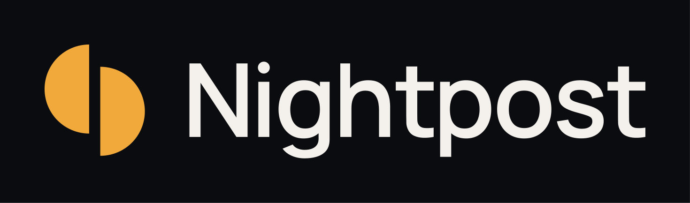
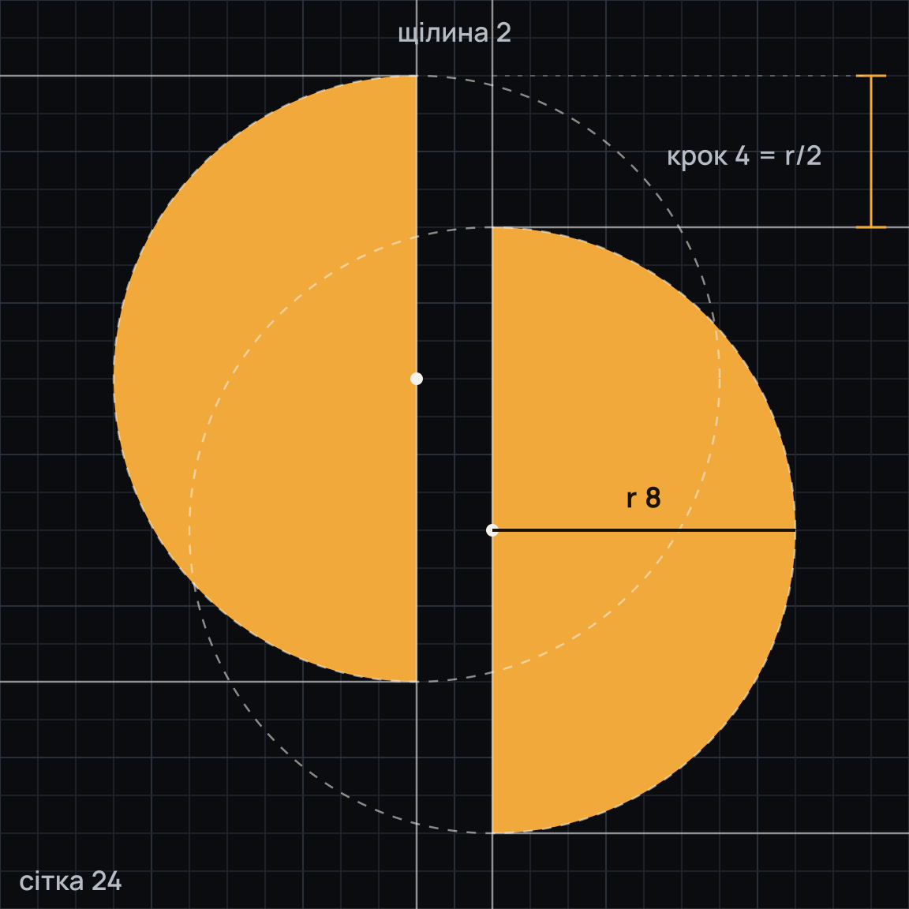
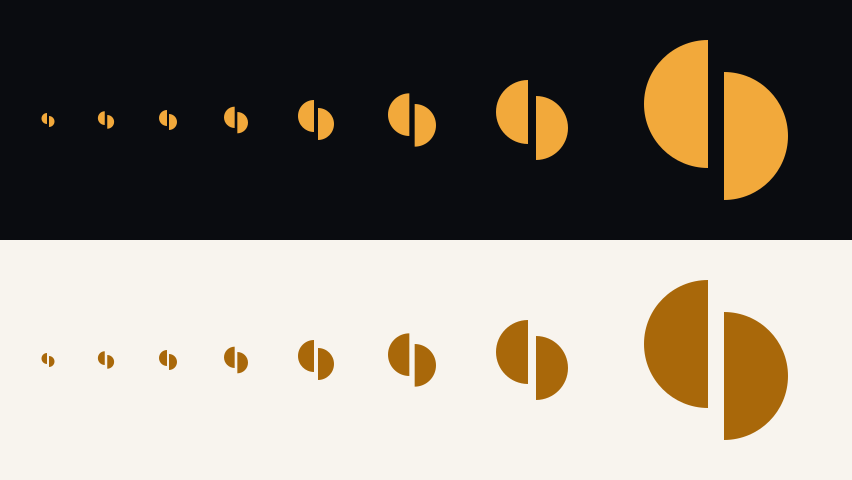
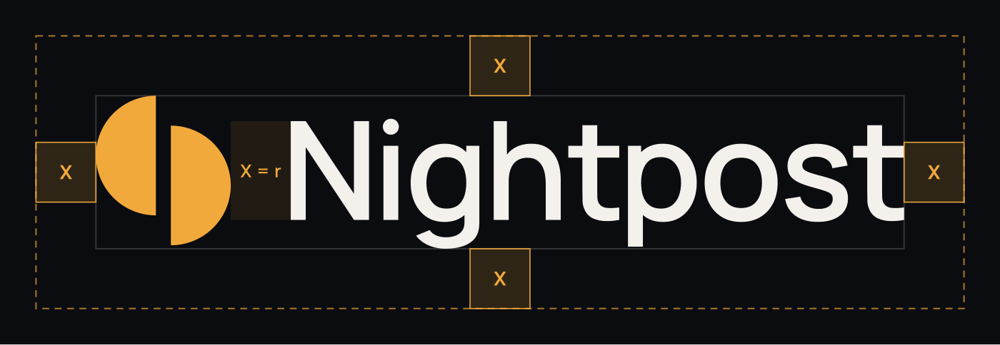
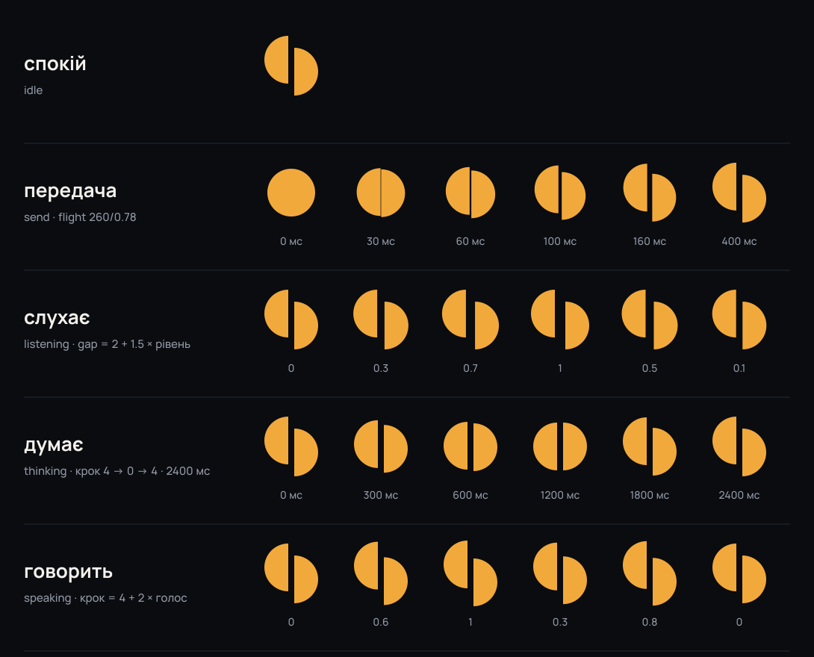

# Nightpost — бренд

*Версія 1.0 · 04.10.2026 · гілка `cloud/brand`. Кольори й шрифт — токени v1.2.0 (`docs/design/system/tokens.json`).
Усі файли в `assets/` і `dappstore/` генерує `src/build.py`; руками їх не правимо.
Вітрина системи — [`index.html`](index.html). Вихідний бриф — [`BRIEF.md`](BRIEF.md).*



## Коротко

Nightpost — це світло, яке не гасне, коли зникає мережа. Знак — одне світло, розрізане навпіл:
дальшу половину передано на крок далі. Щілина між ними — темрява між двома постами, тобто
обрив звʼязку. Світло перетинає її й доходить цілим: обидві половини однакові, як лист, що дійшов
незмінним. Знак не має літер, облич чи фігур — він переживе й наступне перейменування.

| Що | Файл |
|---|---|
| Знак (24, `currentColor`) | `assets/symbol/nightpost-symbol-24.svg` |
| Словесний знак | `assets/wordmark/nightpost-wordmark.svg` |
| Локапи | `assets/lockup/nightpost-lockup-horizontal*.svg`, `…-stacked*.svg` |
| Іконка застосунку | `assets/icon/nightpost-icon.svg`, `assets/android/res/**` |
| Крамниця | `dappstore/` |
| Рух | `assets/motion/motion.json`, `assets/motion/motion-states.png` |

---

## 1. Імʼя

**Nightpost** має два прочитання, і обидва мають триматися:

- **нічний пост** — вартовий, який не спить, щоб інші могли спати. Це пильність;
- **нічна пошта** — лист, що доходить, коли мережа темна. Це доставка.

**Як пишемо**

- `Nightpost` — одне слово, велика N, решта малі. Не `NightPost`, не `NIGHTPOST`, не `Night Post`.
- Латиницею на всіх ринках. Не транслітеруємо («Найтпост» — ні). Український дескриптор — «нічний пост».
- В українському реченні не відмінюємо: «у Nightpost», «з Nightpost», «для Nightpost».
- Слоган: **«Світло не гасне.»** / **"The light stays on."**
- Дескриптор: «Месенджер і мапа, які працюють, коли мережа ні.» / "Messenger and map that keep working when the network doesn't."

**Помічник — теж Nightpost.** Окремого імені в нього немає. Кнопка — «Спитати Nightpost», підпис у
розмові — «Nightpost», говорить від першої особи («я»). Компаньйон (тривимірний персонаж із двома
прорізами теплого світла) — той самий Nightpost, лише з тілом.

**Слово «Phantom» не зʼявляється ніде**: у бренді, лістингу, деці, відео, кадрах. Гаманець Phantom —
спонсор хакатонів і сусід у тій самій крамниці. У коді воно ще живе (імʼя пакета
`local.phantom.companion`, `app_name`, «Спитати PHANTOM», `aria-label`) — див. «Що лишилося власнику».

## 2. Сенс

**Спокійна пильність: світло, яке тримають увімкненим уночі; присутність, яка лишається.**

- **Обіцянка:** коли мережа йде, Nightpost лишається.
- **Почуття:** одне світле вікно на темній вулиці — хтось не спить, і лист дійде.
- **Характер:** нічний вартовий, а не герой. Говорить мало й просто, числа називає точно.
  Не лякає й не хвалиться.
- **Не:** продаж страху, мілітаризм, хакерський нуар, криптохайп, милі маскоти, «магія ШІ».
- **Україна — доказ, не жалість.** «Зроблено там, де мережа гасне» — так. Сльози й руїни в рекламі — ні.

## 3. Голос і тон

Говоримо звичайними людськими словами. Людина бачить листи, телефони й мапу — не протоколи.

**Принципи**

1. **Коротко й по суті.** Одна думка — одне речення. Без вступів і вибачень.
2. **Що сталося і що буде далі.** «Немає звʼязку. Лист піде, щойно він зʼявиться.»
3. **Числа точні.** «до 7 днів», «385 м», «0,25 USDC» — не «скоро», «поруч», «трохи».
4. **Спокій замість тривоги.** Без знаків оклику, без капсу, без «Увага!». Статус — завжди словом, не лише кольором.
5. **Чесність про гроші.** Поруч із будь-якою сумою в тестовій мережі — «тестова мережа (devnet)».
6. **Не хвалимося безпекою.** Ніколи «безпечний», «незламний», «військове шифрування», «на базі ШІ».
   Кажемо, що відбувається: «прочитати можете лише ви двоє».

**Словник: замість жаргону**

| Не кажемо | Кажемо |
|---|---|
| ретранслятор, релей, сховок (як термін) | наш сервер · «лист чекає на сервері до 7 днів» |
| вежі, вузли, ноди, сітка, mesh | телефони поруч · напряму, без інтернету |
| E2E, наскрізне шифрування (у першому рядку) | прочитати можете лише ви двоє (термін — у подробицях) |
| offline-first, офлайн-режим | працює без інтернету |
| devnet / mainnet | тестова мережа (devnet) / основна мережа |
| некастодіальний гаманець | гаманець, який тримаєте лише ви |
| ШІ, нейромережа, AI | помічник · Nightpost |
| синхронізація завершена | оновлено |
| пінг, затримка, пакети | звʼязок слабкий |

**Як це звучить**

| Ситуація | Українською | English |
|---|---|---|
| Немає мережі | Немає звʼязку. Лист піде, щойно він зʼявиться. | No connection. The message will go as soon as there is one. |
| Людини немає поруч | Лист чекає на сервері до 7 днів. Прочитати його можуть лише ви двоє. | The message waits on our server for up to 7 days. Only the two of you can read it. |
| Напряму | Ви в одній мережі Wi-Fi — пишемо напряму. | You're on the same Wi-Fi, so this goes directly. |
| Гроші | 5 USDC · тестова мережа (devnet). Це не справжні гроші. | 5 USDC · test network (devnet). This is not real money. |
| Помилка | Не вдалося надіслати: телефон Олени поза мережею. Спробую ще раз, коли вона зʼявиться. | Couldn't send: Olena's phone is offline. I'll try again when it's back. |
| Помічник | Я тут. Що потрібно? | I'm here. What do you need? |

Уже правильний приклад у застосунку: «1 повідомлення чекає звʼязку».

## 4. Знак «Естафета»



**Побудова.** Сітка 24, один шлях, лише цілі числа:

```
M11 2A8 8 0 0 0 11 18ZM13 6A8 8 0 0 1 13 22Z
```

- дві половини кола, радіус **r = 8**;
- **щілина 2** — темрява між двома постами (обрив звʼязку);
- **крок 4 = r/2** — світло передано далі; крок іде вниз праворуч, уздовж діагоналі N;
- точкова симетрія: оптичний центр збігається з центром сітки;
- без отворів, тож правила заливки `nonzero` і `evenodd` дають однаковий результат — шлях
  вставляється в будь-яке гніздо старого `PHANTOM_MARK_PATH`.

**Мікрокрій для 16–20 px** (сітка 16): `M7 1A5.5 5.5 0 0 0 7 12ZM9 4A5.5 5.5 0 0 1 9 15Z`.
Щілина 2 px і крок 3 px лягають на цілі пікселі (щілина майстра впала б до 1,3 px і розмилася б).
Це той самий знак, намальований під піксельну сітку, а не другий знак. Від 24 px — тільки майстер.



**Чим знак не є.** Не літера, не обличчя, не привид, не капюшон, не щит, не замок, не дуги Wi-Fi,
не вузли, не іскри. Не перемикач теми: обидві половини завжди одного тону й завжди зі зсувом.

## 5. Логотип

### Словесний знак

`Nightpost`, вирізаний із Manrope (варіативний, вага 620) і переведений у криві. Власний набір:

- трекінг −20/2000; ручний кернінг: Ni −70, ig −40, gh −50, ht −10, tp −80, po −25, os −10, st −5;
- крапка над **i** — справжнє коло (світло ставить крапку);
- виносні елементи **g** і **p** укорочено на 90 одиниць, щоб слово сиділо щільно поруч зі знаком.

Шрифт — Manrope (SIL OFL 1.1, `src/fonts/OFL.txt`), тож словесний знак — це модифікований Manrope.
Живим текстом «Nightpost» як логотип не набираємо: лише файл.

### Локапи

| Локап | Коли | Файли |
|---|---|---|
| Горизонтальний | за замовчуванням: шапки, сайт, слайди, банери | `assets/lockup/nightpost-lockup-horizontal*` |
| Стовпчиковий | квадратні й вертикальні формати, заставки, обкладинки | `assets/lockup/nightpost-lockup-stacked*` |
| Лише знак | іконки, аватар, фавікон, де імʼя вже поруч | `assets/symbol/*` |
| Лише словесний знак | коли знак уже є на тому самому екрані | `assets/wordmark/*` |

**Пропорції горизонтального локапа.** Масштаб знака підібрано так, що **щілина знака дорівнює
товщині лівої ноги N** (10,9 одиниці) — N стає конструктивним елементом, а знак не стає літерою.
Знак ≈ 1,51 висоти великої літери й центрований на середині її висоти. Відстань від знака до слова — **X**.

**Стовпчиковий.** Знак у 1,75 раза більший, ніж у горизонтальному, центрований над словом,
на відстані X над лінією великих літер.

Кожен локап є у трьох видах: `*.svg` (`currentColor`, щільна рамка), `*-on-ink.svg` і `*-on-light.svg`
(з тлом і полем X), плюс PNG @1x і @2x з тлом і прозорі (`png/`).

### Охоронне поле



**X = радіус половинки знака (r) у масштабі локапа ≈ 0,6 висоти великої літери.**
Поле X з усіх боків вільне: жодного тексту, краю екрана чи чужого знака. Для одного знака поле — r
(третина його висоти).

### Мінімальні розміри

| Що | Екран | Друк |
|---|---|---|
| Знак | 16 px (16–20 px — мікрокрій; від 24 px — майстер) | 5 мм |
| Словесний знак | 72 px завширшки | 18 мм |
| Горизонтальний локап | 128 px завширшки | 30 мм |
| Стовпчиковий локап | 72 px завширшки | 18 мм |

### Чого не робимо

1. Не вирівнюємо половинки (крок 0) — виходить розрізана пігулка або перемикач теми.
2. Не дзеркалимо й не обертаємо: крок завжди вниз праворуч.
3. Не фарбуємо половинки в різні кольори й не робимо одну контуром.
4. Не додаємо градієнтів, сяйва, тіней, обведення, обʼєму, текстур. Виняток — втиснення в рельєф
   на банерах: це спосіб показу, а не версія знака.
5. Не ставимо бурштин `#F2A93B` на світле тло — там `#A9680A` або чорнило `#17110C`.
6. Не кладемо знак у коло, щит чи плашку — окрім іконки застосунку й аватара.
7. Не міняємо пропорцію знака й слова в локапі, не розтягуємо, не набираємо слово іншим шрифтом.
8. Не пишемо `NightPost`, `NIGHTPOST`, `Night Post`, «Найтпост».
9. Не ставимо поруч зі словом Phantom або старою «P».
10. Не беремо мікрокрій понад 20 px і майстер нижче 24 px.
11. Не кладемо на фото чи гамірне тло без підкладки чорнила.
12. Не робимо знак другим бурштиновим у регіоні: якщо поруч бурштинова кнопка чи крапка
    непрочитаного — знак у кольорі тексту.

## 6. Колір

Бренд не має власної палітри поверх токенів — **бренд і є токени v1.2.0**. Чорнило — ніч, бурштин —
одне світло в ній.

| Роль у бренді | Токен | Ніч | День |
|---|---|---|---|
| Тло («Ніч» / «День») | `canvas` | `#0A0C10` | `#F8F4EE` |
| Знак | `accent` / `accent-line` | `#F2A93B` | `#A9680A` |
| Словесний знак | `text` | `#F4F1EC` | `#17110C` |
| Другий рядок, слоган | `text-2` | `#B6BCC6` | `#4E4339` |
| Тихі підписи, рельєф без світла | `text-3` | `#939AA6` | `#665A4D` |
| Підкладки, плита кадру | `surface` / `raised` | `#12151B` / `#1A1E26` | `#FFFFFF` / `#F0EAE2` |
| Лінії | `line` / `line-strong` | `#232831` / `#343B47` | `#E6DED3` / `#D2C6B7` |
| Бурштин як текст | `accent-text` | `#F5B24A` | `#8A5200` |
| Напис на бурштині | `on-accent` | `#1A1206` | `#1A1206` |

**Кольорові пари логотипа**

- **на чорнилі** (основна): знак `#F2A93B`, слово `#F4F1EC`, тло `#0A0C10`;
- **на світлому:** знак `#A9680A`, слово `#17110C`, тло `#F8F4EE`;
- **один колір:** усе `currentColor` — чорнило на папері, білий на фото з підкладкою, тінт системи
  в тематичній іконці Android.

**Пропорція.** Чорнило — більша частина площі, текст — друга, бурштин — до 5 %: одне світло, не
декорація. Тони людей (червоний, зелений, бірюзовий, синій, фіолетовий, рожевий) — лише для людей,
ніколи для бренду. Поза брендом лишаються кольори сусідів: фіолетовий Phantom, фіолетово-зелений
Solana, бірюзовий Seeker, жовтий Solflare.

**Тверді правила токенів:** `#F2A93B` ніколи не текст і ніколи не позначка на світлому (1,9:1 на
кремовому); не більше однієї бурштинової заливки на регіон екрана; бурштин ніколи не прикраса.

## 7. Типографіка

**Manrope — для всього**, вагами 400/500/600/700; курсиву немає, наголос — вагою 600.
**JetBrains Mono** — лише для блоків коду (і для специфікацій на кшталт шляхів знака в документах).
Inter не використовуємо: `cloud/beta` його прибрав.

| Роль | Розмір / рядок / вага | Трекінг |
|---|---|---|
| display | 28/34/700 | −0,02 em |
| title-1 | 22/28/700 | −0,01 em |
| title-2 | 18/24/600 | −0,005 em |
| headline | 16/22/600 | 0 |
| body | 16/23/400 | 0 |
| callout | 15/20/400 | 0 |
| subhead | 14/20/500 | 0 |
| footnote | 13/18/400 | 0 |
| caption | 12/16/500 | 0 |

**Для маркетингу** (банери, кадри, слайди) — та сама гарнітура, більші щаблі: заголовок 64–78 px / 700 /
−0,02 em, підзаголовок 26–34 px / 500 у `text-2`, мітка розділу 28–32 px / 600 у `accent-text`.
Регістр речення, ніколи не ВЕЛИКИМИ. Числа, час, відстані — з `tnum`.

**Дрейф, який прибрати при підключенні:** `core-design` досі везе `playfair_display.ttf` і
`manrope_extrabold.ttf` — їх немає в специфікації.

## 8. Рух знака й світла

Одна граматика для знака й для двох прорізів світла компаньйона. Параметри знака — щілина `g` і
крок `s`; радіус не змінюється ніколи. Пружини й тривалості — з токенів (`motion.springs`).

```js
// шлях знака для будь-яких g і s (сітка 24); спокій: g = 2, s = 4
const relay = (g, s, r = 8) =>
  `M${12 - g / 2} ${12 - s / 2 - r}A${r} ${r} 0 0 0 ${12 - g / 2} ${12 - s / 2 + r}Z` +
  `M${12 + g / 2} ${12 + s / 2 - r}A${r} ${r} 0 0 1 ${12 + g / 2} ${12 + s / 2 + r}Z`;
```



| Стан | Знак | Світло компаньйона | Пружина / час | Петля |
|---|---|---|---|---|
| **спокій** | стоїть: g 2, s 4 | дихає 80 ↔ 100 % за 4,8 с, лише поки компаньйон на екрані | breath 120/0,85 | знак — ні; компаньйон — так |
| **передача** (лист надіслано, підпис зроблено, перше відкриття) | ціле світло (g 0, s 0) за 150 мс розходиться в спокій | обидва прорізи коротко гаснуть до 60 % і повертаються | flight 260/0,78 | ні |
| **слухає** (мікрофон відкрито) | g = 2 + 1,5 × рівень входу; у тиші g 2 | прорізи розкриваються: висота 1 + 0,3 × рівень | breath 120/0,85 | так, але лише за справжнім рівнем |
| **думає** (чекаємо відповіді > 400 мс) | s: 4 → 0 → 4, 2400 мс | світло передається з прорізу в проріз: 100/55 % ↔ 55/100 %, висота 0,85 | easing standard (0,2, 0, 0, 1) | так |
| **говорить** | s = 4 + 2 × обвідна голосу; паузи повертають 4 | яскравість 75 % + 25 % × обвідна | flight 260/0,78 | так, за голосом |
| **кінець** | повернення в спокій | повернення в спокій | snap 180/0,75 | — |

**Правила.**

- Знак ніколи не рухається «для краси»: лише ці стани. Петлі — тільки поки стан справді живий
  (токени: «only live states loop»). Ніякого вигаданого дихання в тиші.
- Ніякого сяйва, пульсуючого ореолу чи зміни кольору — змінюються лише геометрія (знак)
  і яскравість (прорізи компаньйона).
- «Думає» — це естафета: половини сходяться й розходяться, а в компаньйона світло переходить
  із прорізу в проріз. Обидва розповідають ту саму історію, що й знак.
- **Менше руху** (`prefers-reduced-motion`, системне налаштування Android): усе тримає спокій,
  а стан кажемо словами — «слухаю», «думаю».
- Де звучить: аватар Nightpost у розмові (диск кольору тексту, знак кольору тла —
  `assets/symbol/nightpost-avatar-*.svg`), кнопка «Спитати Nightpost», заставка.

Машинний опис — `assets/motion/motion.json`; живий показ — у `index.html`.

**Про компаньйона.** Прорізи світла — для персонажа в застосунку, не для іконки: силует із двома
світлими очима як іконка надто близький до привида Phantom. Контракт familiar v4 (галактика в
капюшоні, сталеві кінцівки, градієнтні стрічки, кристали) цій граматиці суперечить — повертаємо його
до двох теплих прорізів у кольорі `#F2A93B` на чорнилі. Рішення — за власником.

## 9. Іконографія

- **Основа — Lucide** (`lucide-react` у вебі), лінія **1,75** (токен `icon-stroke`), сітка 24,
  розміри 16 / 20 / 24 (`icon-s/m/l`). Округлі закінчення й зʼєднання.
- **Свої іконки** малюємо на тій самій сітці: 2 px поля, та сама лінія, без заливок, окрім крапок до 4 px.
- **Метафори з фізичного світу:** конверт, мапа, шпилька, ключ, лампа, двері. Не технічні:
  без дуг Wi-Fi для «напряму», без графа вузлів для «телефони поруч», без щита й замка для
  приватності — замість них слова («прочитати можете лише ви двоє»).
- **Бурштин лише в активному стані** (активна вкладка, фокус) — одне світло на регіон.
- **Стан — завжди з словом.** Іконка без підпису не несе важливого стану.
- **Знак — не іконка дії.** Ним не позначаємо «надіслати», «мережу» чи «завантаження»; він лише
  означає Nightpost (аватар, іконка, заставка).
- **Без емодзі** в системних текстах і кнопках.

## 10. Рельєф і світло в рекламі

Мотив — **рельєф району ізолініями**, той самий генератор (mulberry32, зерно місця з кроком ≈ 10 км), що
малює рельєф під розмовами в застосунку й на сайті; зерно реклами — Київ. Знак **втиснено** в рельєф
плато: ізолінії обходять обидві половини й щілину.

- **Ніч:** лінії підсвічує власна лампа поста — схили, що дивляться на знак, бурштинові, решта тихі.
- **День:** світло сонця з лівого верхнього кута, лінії `#A9680A` на папері.
- Світло низьке, тепле й спрямоване. Ніколи не сяйво, плями чи градієнти.

Файли: `assets/art/relief-night-1600x900.jpg`, `…-day-…`, банери в `dappstore/`. На сайті (`world.ts`,
`markMask`) «P» у рельєфі замінюємо на шлях Естафети — при підключенні.

## 11. Носії

Нічого з цього **ще не підключено** в застосунок і сайт — там зараз працюють інші. Файли готові до
перенесення одним комітом.

| Носій | Файл | Куди піде |
|---|---|---|
| Адаптивна іконка | `assets/android/res/drawable/ic_launcher_foreground.xml`, `…_monochrome.xml`, `mipmap-anydpi-v26/ic_launcher*.xml` | `phantom-companion/app/src/main/res/` |
| Тло іконки | `#0A0C10` (`ic_launcher_background` уже є в `values/colors.xml`) | — |
| Заставка Android 12+ | `ic_splash_mark.xml` (288 dp, знак 80 dp у колі d192) + `values*/brand_colors.xml` | там само |
| Іконка сповіщень | `ic_stat_nightpost.xml` (24 dp, мікрокрій, лише альфа) | там само; 19 місць, що зараз беруть `ic_launcher_monochrome` |
| Знак у застосунку | `ic_nightpost_symbol.xml` (24 dp) | `core-design` |
| Знак у вебі | `assets/symbol/nightpost-symbol-24.svg` (шлях) | `PhantomMark.tsx` → `NightpostMark.tsx`, `identity.test.tsx` |
| Фавікони | `assets/favicon/*` (`favicon.svg` сам перемикає колір за темою браузера) | `phantom-os/src/frontend/public`, `platform-site/public` |
| ПК (Tauri) | `assets/tauri/*` (32, 128, 128@2x, `icon.png`, `icon.ico`, джерело 1024) | `src-tauri/icons/`; `.icns` — `tauri icon assets/tauri/icon-src.png` |
| Google Play | `assets/play/play-icon-512.png` (32-біт), `feature-graphic-1024x500.png` (без альфи) | консоль Play |
| dApp Store | `dappstore/` (іконка 512, банер, Editor's Choice, рамка кадрів, лістинг) | портал |

Адаптивна іконка: знак 44 dp заввишки на полотні 108 dp; найдальша точка — 22,5 dp від центру
(безпечне коло — 33 dp; `build.py` перевіряє це assert-ом). Тематична іконка (Android 13+) — той самий
знак одним кольором, форму несе альфа.

Старий шлях «P» живе в 12 файлах `cloud/beta` (перелік — `BRIEF.md`, §5.4) плюс `world.ts`, іконки Tauri
і чернетки на `cloud/sol-dappstore`. Сторожі `identity.test.tsx` і `HomeOpensOnPhantomTest` міняємо
разом із шляхом.

## 12. Перевірка: що попросило журі і що зроблено

Із трьох напрямів журі (троє суддів) найвище оцінило **«Естафету»** (7 / 7,5 / 5). Що змінено:

| Зауваження | Що зроблено | Доказ |
|---|---|---|
| На 24–48 px крок 2,5 зникає, лишається «коло з рискою» | крок 4 (= r/2, ціле число), щілина 2; окремий мікрокрій для 16–20 px | `review/size-ladder.png`, `review/confusability.png` (до/після) |
| Читається як перемикач теми | обидві половини завжди одного тону, без контуру; зі зсувом 4 силует перестає бути «наполовину залитим колом»; вирівнювання заборонене | `review/confusability.png` |
| На іконці коло в колі — «просто крапка» | знак 44 dp на полотні 108 — є повітря, але щілина й крок лишаються видимими в масках кола й сквірклу | `assets/android/preview/launcher-*.png` |
| Порівняти з сусідами на справжньому екрані | у чернетці — сітка головного екрана на 32 і 48 px (коло й сквіркл) поруч з іконками Phantom, Solflare і Backpack із відкритого набору web3icons: Nightpost не схожий на жодну. Чужих знаків у репозиторії не тримаємо | `review/confusability.png` (з типовими двійниками); остаточна перевірка — на телефоні власника |
| «Розрізане коло» — заселений жанр | власний крок r/2 і правило «щілина = нога N» роблять знак своїм; юридична чистота — лише пошуком | EUIPO / USPTO, класи 9, 38, 36 |

**Що взяли з інших напрямів.** Від «Нахилу» — ручний крій під 16 px (тут — мікрокрій) і думку, що знак
народжується з прорізів світла компаньйона (тепер це спільна граматика руху: «думає» — світло
переходить із прорізу в проріз). Від «Печатки» — сенс запечатаного листа: він у голосі («Запечатано,
доки не дійде») і в кадрі «Засвідчіть файл», а також вимогу, щоб шлях однаково заливався за
`nonzero` і `evenodd`. Від самої «Естафети» з першого раунду — етюд руху «передача».

## 13. Що лишилося власнику

1. **Імʼя пакета** (`local.phantom.companion(.seeker)`) — вирішити до першого подання в dApp Store.
2. **Перейменування в застосунку:** `app_name`, «Спитати PHANTOM», `aria-label`, рядок «PHANTOM» у списку розмов.
3. **Домен і адреси** для полів порталу (сайт, умови, приватність, пошта) — без слова Phantom.
4. **Пошук знака** EUIPO і USPTO, класи 9, 38, 36.
5. **Порівняння на телефоні:** іконка Nightpost поруч із Phantom, Solflare, Backpack і Jupiter на головному екрані.
6. **Компаньйон:** повернути familiar v4 до двох теплих прорізів або змінити бриф.

## 14. Як перебудувати

```bash
cd docs/brand/src
python3 -m venv .venv && .venv/bin/pip install -r requirements.txt
.venv/bin/python build.py              # усе в docs/brand/assets, dappstore, review
bash ../dappstore/frame/render.sh --example                       # приклад рамки (один браузер, під замком)
bash ../dappstore/frame/render.sh frames.en.tsv ../previews/en    # справжні кадри
```

Потрібні `rsvg-convert` і ImageMagick 7 (`magick`). Шрифт — `src/fonts/Manrope.ttf` (OFL) або
змінна `MANROPE_TTF`.
